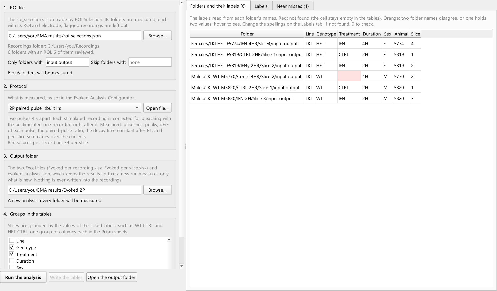
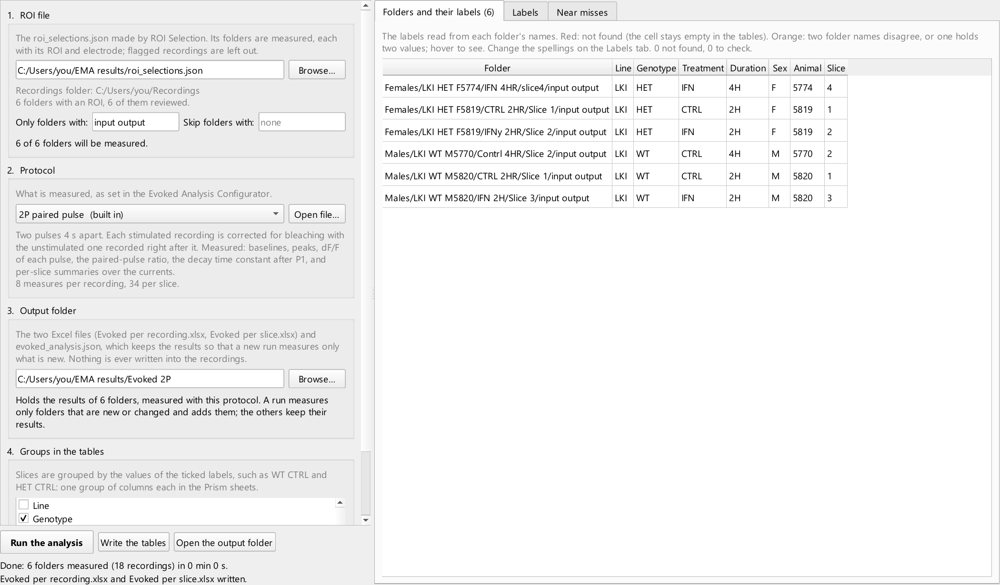

Evoked Analysis
===============

The evoked analysis measures every recording of the folders in an ROI file
with a protocol, and writes two Excel files laid out for Prism: one row per
recording in the first, one row per slice in the second. Each row carries
labels read from its folder names, such as the genotype and the
treatment.

It needs

* the **ROI file** (``roi_selections.json``) made by :doc:`ROI Selection
  <../roi_selection/index>`: the ROI and electrode of every folder, and the
  recordings that were flagged;
* a **protocol** made in the :doc:`Evoked Analysis Configurator
  <../evoked_configurator/index>`, or one of the built-in protocols;
* an **output folder**, outside the recordings.

   The Evoked Analysis window. Left: the ROI file, the protocol, the output
   folder and how the tables are grouped. Right: every folder that will be
   measured, with the labels read from its folder names. The red cell is a
   label that was not found: the folder is called ``Contrl 4HR``, which is
   not a spelling of CTRL yet.

Step by step
------------

1. **ROI file.** Choose the ``roi_selections.json`` of ROI Selection. Its
   folders are listed on the right. Use **Only folders with** to keep the
   folders of one kind of recording: ``input output`` for the 2P protocol,
   ``11p`` for the 11P protocol. A protocol measures every folder it is
   given, so a 2P protocol run on a train folder would measure the train
   recordings as if they were paired pulses.
2. **Protocol.** Choose a protocol from the library, or **Open file…** for a
   protocol file kept elsewhere. Its description and the number of measures
   are shown under it, with a warning if it has no per-slice measures.
3. **Output folder.** Choose a folder outside the recordings. If it holds an
   earlier analysis, its labels and groups are shown, and a line says what a
   run will do (see :ref:`running-again`).
4. **Labels.** Check the table on the right. A red cell is a label that was
   not found in the folder names; an orange one needs a look (hover over
   it). Look at the **Near misses** tab: words that look like a spelling of
   a label but are not one. See :doc:`labels`.
5. **Groups.** Tick the labels that form the groups of the Prism sheets,
   such as *Genotype* and *Treatment* for the groups WT CTRL, WT IFN,
   HET CTRL and HET IFN. See :doc:`tables`.
6. Press **Run the analysis**. The progress bar shows the recording being
   measured. **Stop** stops after that recording; the folders measured so
   far are kept, and the next run measures the rest.

When it is done, both Excel files are in the output folder, and the summary
under the buttons says how many folders and recordings were measured and
how many were not (the *Notes* sheet of each file says why).

   After a run: the summary, and the two files written.

What is measured in each folder
-------------------------------

Each recording folder is one **slice**. In it, the protocol chooses the
recordings to measure: every stimulated recording (all but the ``no`` files
and those with a skip word such as ``red``), or the recordings it lists.
Then, for each recording:

* A recording flagged in ROI Selection is left out. A flagged unstimulated
  recording is never used as a partner.
* The unstimulated partner is found as the protocol says (see
  :doc:`../evoked_configurator/measures`).
* The trace is the mean of the pixels inside the folder's ROI in each
  frame, combined with the partner's trace as the protocol says. Spatial
  measures use every pixel, with the folder's electrode.
* Every per-recording measure of the protocol is measured, exactly as the
  configurator shows it on an example recording.
* The **condition** of the recording is the one the protocol lists for it
  (such as a recovery delay), or else the number its file name starts with:
  300 for ``300uA.tif``.

The per-slice measures are then made from the recordings of the folder, as
the protocol's summary says.

A recording that cannot be measured is listed on the *Notes* sheet with
the reason: flagged, not in the folder, no unstimulated partner, a
different image size from the ROI file's, or a file that cannot be read.

.. _running-again:

Running again
-------------

Everything about an analysis is kept in its output folder, in
``evoked_analysis.json``: the protocol, the labels, the groups, and the
results of every folder. A new run with the same output folder measures
only what it has to:

.. list-table::
   :header-rows: 1
   :widths: 45 55

   * - Since the last run
     - What happens
   * - Nothing changed
     - Nothing is measured; the files are written again (in seconds).
   * - New folders in the ROI file
     - Only the new folders are measured, and added to the files.
   * - A folder's ROI, electrode or flags changed, or a recording was added,
       replaced or removed
     - That folder is measured again.
   * - A folder is no longer in the ROI file (or the folder filter)
     - EMA asks whether to keep its results. Keep them to collect the
       folders of several ROI files in one analysis; drop them when they are
       the same recordings in another place (another computer, a moved
       folder), so they are not in the tables twice.
   * - The labels or the groups changed
     - Nothing is measured; press **Write the tables**, or run.
   * - The protocol changed (any setting), or EMA was updated
     - Every folder is measured again with the new protocol, and both files
       are replaced. EMA asks first.

To keep the results of an old protocol, choose a new output folder for the
new one.

The Excel files are written again from ``evoked_analysis.json`` after every
run, so changes made in them by hand are lost: copy what you need into
Prism or another file. If a file is open in Excel, it cannot be replaced:
close it and press **Write the tables**.

.. toctree::
   :maxdepth: 2

   labels
   tables
