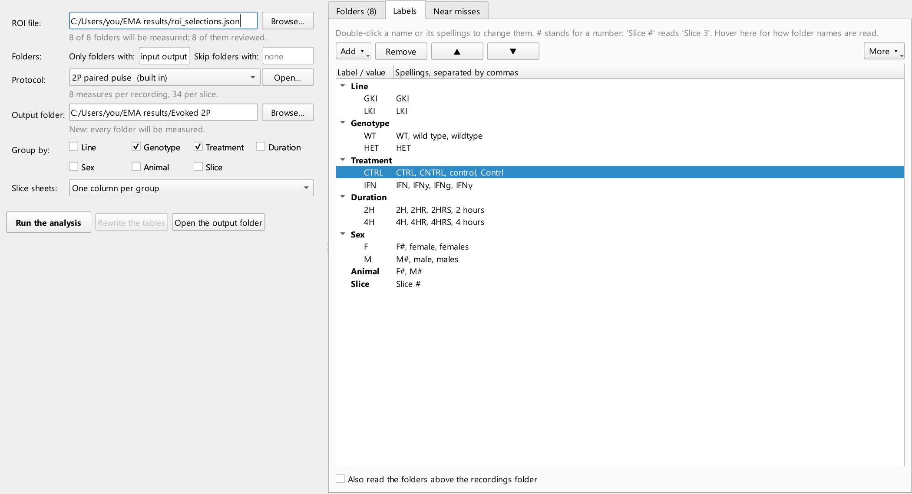
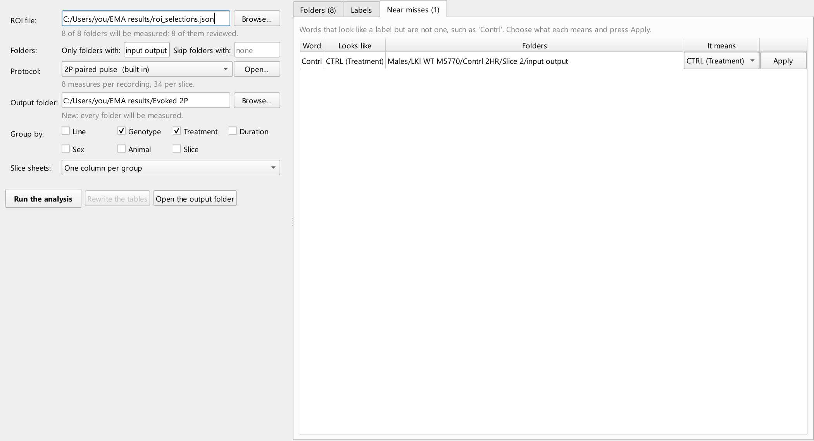

Labels from folder names
========================

Every row of the tables carries **labels** read from the names of its
folders: the line, genotype, treatment, duration, sex, animal and slice, for
example. They are set on the **Labels** tab and checked on the **Folders
and their labels** and **Near misses** tabs.

   The Labels tab with the labels EMA starts with. *Contrl* was just added
   to the spellings of CTRL from the Near misses tab.

Labels, values and spellings
----------------------------

A **label** (Genotype) has **values** (WT, HET), and each value has the
**spellings** that mean it in a folder name (WT, wild type, wildtype).

A **number label** (Slice) has no values. Its spellings hold a ``#`` where
the number is, and its value is that number: ``Slice #`` gives 3 for
``Slice 3``.

How a spelling is found
-----------------------

Each folder name is cut into **words**: at spaces and punctuation, and
where letters meet digits. Upper and lower case count as the same. So
``IFNy_4hr`` is the words *ifny*, *4*, *hr*, and ``LKI HET M5821`` is *lki*,
*het*, *m*, *5821*.

A spelling matches a folder name when its words appear in it one after the
other. In a spelling, ``#`` stands for any number.

.. list-table::
   :header-rows: 1
   :widths: 20 40 40

   * - Spelling
     - Matches
     - Does not match
   * - ``4H``
     - ``IFN 4H``, ``IFNy_4h``, ``CTRL 4h``
     - ``IFN 14H``, ``IFN 4HR`` (*hr* is another word than *h*)
   * - ``Slice #``
     - ``Slice 3``, ``slice3``, ``Slice 3 (rostral)``
     - ``extra slice (rostral)`` (no number)
   * - ``F#``
     - ``GKI WT F5463 CG``
     - ``Females`` (no number after the F)
   * - ``wild type``
     - ``wild type``, ``Wild_Type``
     - ``wildtype`` (one word: give it as a spelling of its own)

Which folder gives the value
----------------------------

The folders of a recording folder's path are read from the **innermost
out**: for ``Females/LKI HET F5819/IFNy 4HR/Slice 2/input output``, first
``input output``, then ``Slice 2``, ``IFNy 4HR``, ``LKI HET F5819`` and
``Females``. The first folder that holds a label gives its value. In this
example the labels are LKI, HET, IFN, 4H, F, 5819 and 2.

Only the folders inside the recordings folder of the ROI file are read,
unless **Also read the folders above the recordings folder** is ticked. Tick it when a label is only in the name of the recordings folder
itself, for example when the ROI file was made for one animal's folder.

The table on the **Folders** tab shows the value of every
label for every folder:

* **Red**: the label was not found. Its cell stays empty in the tables, and
  in the Prism sheets the slice goes into a group such as
  *(no Genotype) CTRL*.
* **Orange**: one folder name holds two values of the label (such as
  ``WT HET``), which leaves it empty; or two folder names disagree, such as
  an animal folder filed inside another animal's folder. The innermost one
  is used. Hover over the cell to see which folders.

The orange ones, and the red ones of the labels the slices are grouped by,
are also listed on the *Notes* sheet of the tables.

Near misses
-----------

A **near miss** is a word in a folder name that is not a spelling but looks
like one. The **Near misses** tab lists each one, with the spelling it looks
like and the folders it is in.

   One near miss: *Contrl*, which looks like CNTRL, a spelling of CTRL.

A word of three letters or more is a near miss of a spelling's word when

* one or two letters are off: a letter missing, added, changed, or two
  letters swapped (``HTE`` for HET, ``Slcie`` for Slice; one letter for
  words of up to five letters, two for longer words);
* one starts with the other (``IFNy`` and IFN, ``Controls`` and control);
* one is a short form of the other: it starts with the same letter, has the
  other letters in the same order, and is at least half as long (``CNTRL``
  and control).

Choose what each near miss means under **It means** and press **Apply**:

* a value: the word (in a number label, the spelling with the word in it,
  such as ``Slcie #``) is added to the spellings of that value, and the
  folders that hold it get that value;
* **Not a label**: the word is never shown as a near miss again.

The labels EMA starts with
--------------------------

These match the folder names of the lab's recordings, such as
``Males/LKI WT M5820/CTRL 2HR/Slice 1/input output``:

.. list-table::
   :header-rows: 1
   :widths: 18 82

   * - Label
     - Values and spellings
   * - Line
     - GKI: GKI. LKI: LKI.
   * - Genotype
     - WT: WT, wild type, wildtype. HET: HET.
   * - Treatment
     - CTRL: CTRL, CNTRL, control. IFN: IFN, IFNy, IFNg, IFNγ.
   * - Duration
     - 2H: 2H, 2HR, 2HRS, 2 hours. 4H: 4H, 4HR, 4HRS, 4 hours.
   * - Sex
     - F: F#, female, females. M: M#, male, males.
   * - Animal
     - The number in F# or M#: 5820 for ``M5820``.
   * - Slice
     - The number in Slice #.

A folder named ``CTRL`` without a duration gets no duration.

Changing the labels
-------------------

On the **Labels** tab:

* **Add** adds a label (with one value), a number label, or a value of the
  selected label.
* Double-click a name, a value or a list of spellings to change it.
  Spellings are separated by commas.
* **Remove**, ▲ and ▼ remove and move the selected label or value. The
  order of the values is the order of the groups in the tables (WT before
  HET).
* **More** holds *Restore the defaults* (the labels above), *Export…* (save
  the labels in a file, to share them) and *Import…* (read such a file, or
  the labels of another analysis from its ``evoked_analysis.json``).

The labels are kept with the analysis in its output folder, and EMA starts
the next new analysis with the labels last used.
