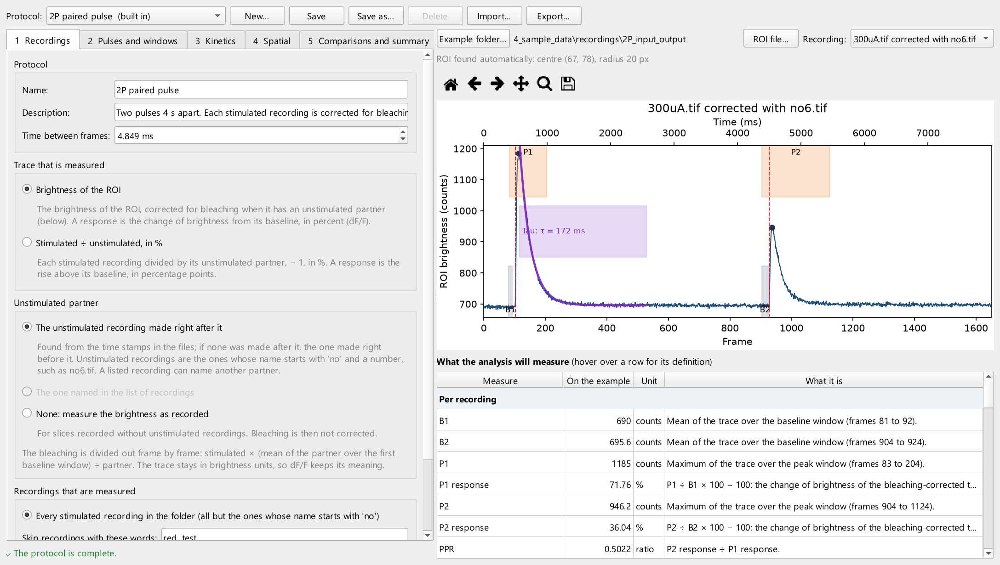

Evoked Analysis Configurator
============================

The configurator makes :term:`protocols <protocol>`. A protocol tells the
Evoked Analysis what to measure in a recording of an evoked response:

* which :term:`trace` is measured, and which recordings;
* the :term:`baseline window` and the :term:`peak window` of every
  :term:`pulse`;
* what is derived from them: :term:`comparisons <comparison>`,
  :term:`exponential fits <exponential fit>`, kinetic measures of each
  pulse's time course, and spatial measures of how its response spreads
  over the slice and how that spread changes as it decays;
* one value per slice from all its recordings, including curves fitted
  across the recordings of a slice.

Protocols are kept in a :term:`library` inside EMA, so the analysis can use
them by name. Every protocol is built from one template: a train of pulses
with an optional recovery pulse.

   The configurator with the built-in 2P protocol. Left: the protocol, in
   five tabs. Right: the protocol tried on a real recording, with its
   windows and fit on the trace, and every measure it will produce, with
   its value on that recording.

Three protocols are :term:`built in <built-in>`:

.. list-table::
   :widths: 25 75

   * - **2P paired pulse**
     - Two pulses 4 s apart. Each stimulated recording is corrected for
       :term:`bleaching` with the unstimulated recording made right after
       it. Measured: the baselines B1 and B2, the peaks P1 and P2, the
       response (dF/F) of each pulse, the paired-pulse ratio (:term:`PPR`),
       and the decay time constant after P1. Per slice: the minimum, maximum
       and mean of each over the recordings, the mean over 100 to 400 µA,
       and how much the baselines drifted.
   * - **2P paired pulse, uncorrected**
     - The same, with every recording measured as recorded, without an
       unstimulated partner: for slices recorded without unstimulated
       recordings.
   * - **11P pulse train**
     - Ten pulses at 10 Hz and a recovery pulse 0.5 to 5 s later. Each
       stimulated recording (``hi1`` … ``hi4``) is divided by the
       unstimulated recording listed with it (``no2`` … ``no5``). Measured:
       the baseline BL before the train, P1 … P10, the recovery pulse P11
       above its own baseline, P2/P1, P10/P1, P11/P1, P11/P10, and every
       pulse's response relative to P1's (named nP1/BL … nP10/BL: each pulse's response, normalised to P1's).

Built-in protocols are read-only. Change one and press *Save*: EMA asks for
a new name and keeps your version as a protocol of your own.

.. toctree::
   :maxdepth: 2

   walkthrough
   measures
   measure_reference
   choosing_measures
   protocol_file
