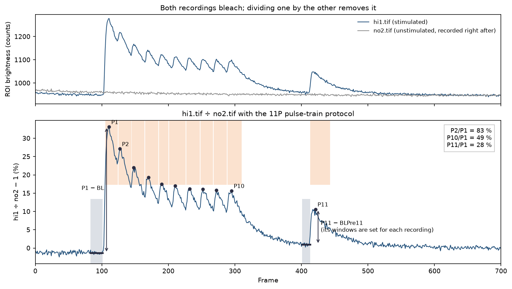
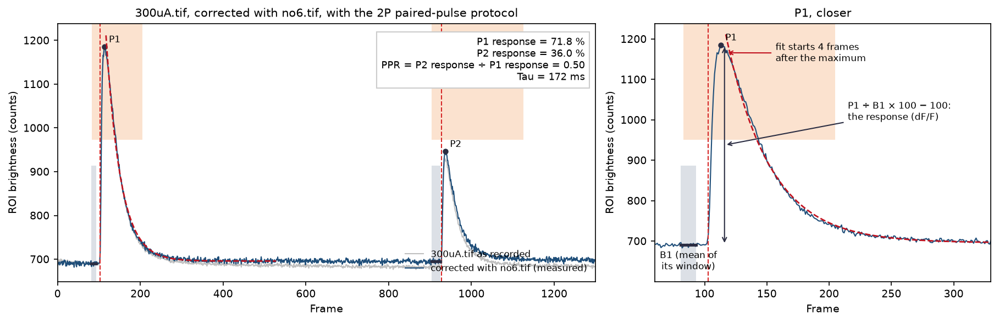
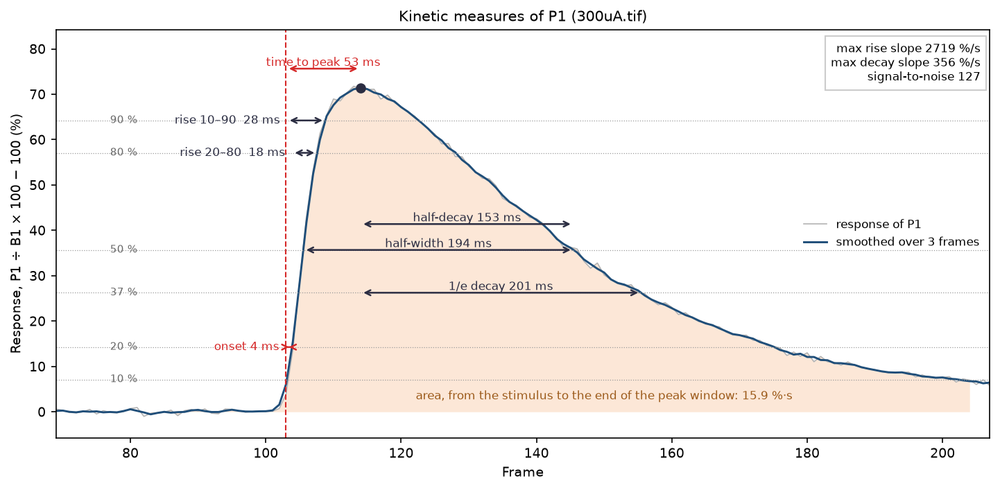
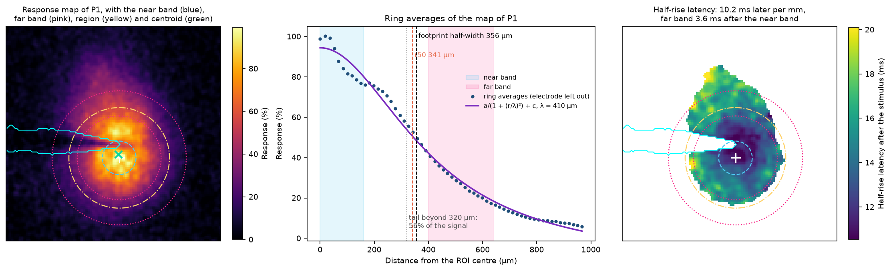
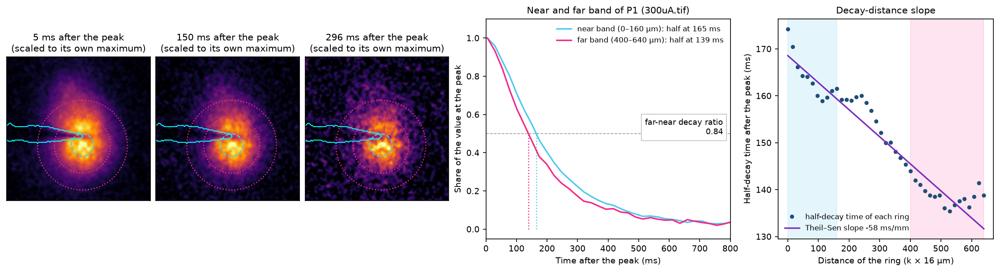

What a protocol measures
========================

All figures on this page are drawn from the sample recordings by EMA's own
measuring code, with the built-in protocols. Frames count from the second
frame of the TIFF (see :doc:`../recordings`). Every kinetic and spatial
measure is described in full, with its formula and its pitfalls, in
:doc:`measure_reference`.

The trace
---------

The ROI brightness of a recording, *F(t)*, is the mean of the pixels of the
ROI in frame *t*. The light that excites the sensor also bleaches it, so
*F* slowly falls during a recording whether or not the slice is stimulated
(:term:`bleaching`). An **unstimulated partner** is a recording made the
same way without a stimulus; its ROI brightness *U(t)* shows the bleaching
alone. Unstimulated recordings are the ones whose name starts with ``no``
and a number (such as ``no6.tif``), unless the name holds a word under
*Skip recordings with these words*.

How a stimulated recording finds its partner is part of the protocol:

.. list-table::
   :header-rows: 1
   :widths: 30 70

   * - Unstimulated partner
     - Which recording
   * - **Made right after it** (the default)
     - The unstimulated recording whose time stamp is the first one after
       the stimulated recording's. When none was made after it, the one made
       last before it. The time stamp is the date and time the camera
       software writes into the TIFF (its *DateTime* tag), to the second. A
       listed recording that names a partner uses that one instead.
   * - **Named in the list**
     - The one named in the recording's row of the list of recordings.
   * - **None**
     - No partner: the brightness is measured as recorded, and bleaching is
       not corrected. For slices recorded without unstimulated recordings.

A recording whose partner cannot be found (no time stamp, no unstimulated
recording in the folder, or a named file that is missing) is not measured,
and the reason is given.

The trace that is measured is then one of:

.. list-table::
   :header-rows: 1
   :widths: 30 40 30

   * - Trace
     - Formula, frame by frame
     - Unit
   * - Brightness, no partner
     - *F(t)*
     - counts (camera units)
   * - Brightness, with a partner
     - *F(t)* × *Ū* ÷ *U(t)*, where *Ū* is the mean of *U* over the
       protocol's first baseline window
     - counts, on the scale of *F*
   * - Stimulated ÷ unstimulated
     - (*F(t)* ÷ *U(t)* − 1) × 100
     - % (of the unstimulated brightness)

With a partner, the bleaching of *F* is divided out. In the brightness case
the factor *Ū* puts the result back on the scale of the stimulated
recording, so baselines and peaks stay in counts. *Ū* is the same number in
every frame, so it cancels in every response (peak ÷ baseline): dF/F, the
paired-pulse ratio and the fits do not depend on which window *Ū* is taken
from. In the first baseline window itself the corrected trace is close to
*F*, because *U* is close to *Ū* there.

The correction assumes that the stimulated and the unstimulated recording
bleach alike: same light, same exposure, same number of frames, made
minutes apart in the same slice. Two recordings with different numbers of
frames cannot be paired.

On the spatial tab, the movie is corrected in the same way, pixel by pixel:
each pixel of the stimulated recording is divided by the same pixel of the
partner (pixels darker than 1 count in the partner are counted as 1).

   The 11P protocol on ``hi1.tif`` ÷ ``no2.tif``.

Baselines, peaks, responses and fits
------------------------------------

   The 2P protocol on ``300uA.tif``. Grey bands are baseline windows, orange
   bands peak windows, red dashed lines stimuli, and the dashed curve the
   exponential fit after P1. In the configurator a fit is a purple band with
   its fitted curve and its τ written on it.

.. list-table::
   :header-rows: 1
   :widths: 22 78

   * - Measure
     - Definition
   * - Baseline (B1, BL …)
     - The mean of the trace over the baseline window.
   * - Peak (P1 peak, P2 peak …)
     - The maximum of the trace over the peak window, with the baseline still
       in it. The response takes the baseline out: use the response. Written
       only when *Write the peak of each pulse too* is ticked (tab *Pulses and
       windows*).
   * - Response, brightness trace (with or without a partner)
     - Peak ÷ baseline × 100 − 100: the change of brightness in percent
       (dF/F).
   * - Response, stimulated ÷ unstimulated trace
     - Peak − baseline: the rise above the baseline, in percentage points of
       the trace.
   * - Comparison (PPR, P2/P1 …)
     - The response of one pulse ÷ the response of another; × 100 when it is
       given in percent.
   * - Single exponential fit (Tau …)
     - The time constant τ, in ms, of A·exp(−t/τ) + C fitted to the trace by
       :term:`least squares`. The fit starts a set number of frames after the
       maximum inside a pulse's peak window (or at a fixed frame) and lasts a
       set number of frames, or up to the end of the recording.
   * - Double exponential fit
     - A1·exp(−t/τ1) + A2·exp(−t/τ2) + C fitted the same way. It gives
       *fast* (τ1, ms), *slow* (τ2, ms) and *fast fraction*
       A1 ÷ (A1 + A2), at the first frame of the fit.

A value that cannot be measured, for example because its window starts
after the end of the recording or a fit does not converge, is left empty.
:doc:`measure_reference` gives each of these measures in full: its formula,
how it is computed, exactly when it is empty, what to be careful of, and a
worked example.

Kinetic measures
----------------

   Every kinetic measure of P1 in ``300uA.tif``.

The kinetic measures describe the time course of each chosen pulse. They are
measured on its **response**: the trace as a change from that pulse's
baseline, in percent, smoothed with a running mean over a few frames (3 by
default). Only the stretch from the pulse's stimulus (or the start of its
peak window, if that is earlier) to the end of its peak window is used. A
time at which the response crosses a level is found between two frames by
straight-line interpolation; times before the maximum are the last crossing
before it, times after the maximum the first one after it.

.. include:: ../_generated/kinetic_measures.rst

See :doc:`measure_reference` for each one's formula, when it is empty, and
what to be careful of. A level that is not crossed inside the stretch gives an empty value. This
is common in a fast train: when the next pulse comes before the response
has decayed to half, the half-width and decay times of the pulse cannot be
measured, and the rise of a later pulse does not start from its baseline.
Measure the kinetics of train pulses with care, and prefer the first pulse.

Spatial measures
----------------

   The spatial measures of P1 in ``300uA.tif``, with the electrode (cyan)
   left out.

The spatial measures describe how the response of a pulse is spread over the
slice around the ROI centre. They use the whole movie, not only the ROI:

1. **Response map.** The response of every pixel, as for the trace (a change
   from the pulse's baseline window, in percent), averaged over a few frames
   around the peak of the ROI trace, then blurred a little.
2. **Rings.** The map is averaged in :term:`rings <ring>` one pixel wide
   around the :term:`ROI centre`. Pixels under the stimulating electrode
   (from ROI Selection, or found automatically) are left out when *Leave
   out the electrode* is ticked (the default), and a ring less than a
   quarter inside the image is left empty.
3. **Measures** of the map and its rings, below.

.. include:: ../_generated/spatial_measures.rst

**Release spread** uses the time course of every pixel:

1. Each pixel's response is smoothed over 3 frames and 1.5 pixels.
2. A pixel gets a half-rise latency when its peak is more than 10
   :term:`SDs <SD>` of its baseline and at least 30 % of the strongest
   pixels' peak. The latency is the time after the stimulus at which its
   response, going back from its peak, falls to half.
3. The median latency of each ring gives the latency slope and the far-near
   delay.

Decay with distance
~~~~~~~~~~~~~~~~~~~

The measures of the group *Decay with distance* follow the response map
from the peak on, in bins as long as the response map (24 ms by default),
and ask how long each part of it takes to fall to half: the near band, the
far band, and every ring. :doc:`measure_reference` gives the details.

   The decay of P1 in ``300uA.tif`` (corrected with ``no6.tif``). Left: maps
   of three bins, each scaled to its own maximum. Middle: the near and the
   far band, each as a share of its value at the peak; the dotted lines mark
   when each has fallen to half. Right: the half-decay time of every ring
   against its distance, with the Theil–Sen line whose slope is the
   decay-distance slope.

On this recording the far band falls to half 26 ms sooner than the near
band (far-near decay ratio 0.84), and the half-decay time shortens by
58 ms per mm: the response is cleared a little faster far from the centre,
so the footprint narrows as it fades.

How the maps and rings are made is set on the Spatial tab:

.. include:: ../_generated/spatial_settings.rst

Slice summaries
---------------

A slice summary combines the recordings of one slice (one recording
folder) into one value per measure:

* the **minimum**, **maximum** and **mean** over all recordings, ignoring
  empty values;
* **means over some of the recordings**: over the recordings with a
  condition in a range, for example a current from 100 to 400 µA, both
  included, or over the recordings with certain file names, for example
  ``hi*`` for ``hi1.tif`` to ``hi4.tif`` (``*`` stands for any characters;
  several names are separated by commas). A summary can have several, each
  with its own name;
* the **baseline spread** of each baseline window: (largest − smallest) ÷
  smallest × 100 over the recordings, which shows how much the baseline
  drifted during the experiment.

:doc:`measure_reference` describes each in full, with an example.

Every measure of a protocol is summarised, the kinetic and spatial ones
included.

Fits across conditions
~~~~~~~~~~~~~~~~~~~~~~

A fit across conditions fits a curve, per slice, to one per-recording
measure against the :term:`condition` of the slice's recordings, by least
squares. Two curves are offered (see :term:`recovery curve` and
:term:`saturation curve`):

.. list-table::
   :header-rows: 1
   :widths: 18 40 42

   * - Curve
     - Formula (*x* the condition, *y* the measure)
     - Gives
   * - Recovery
     - *y* = plateau − (plateau − start) · exp(−*x* ÷ τ)
     - **time constant** τ (in the condition's unit): the condition by
       which *y* has recovered 63 % of the way from start to plateau;
       **start**: *y* at a condition of 0; **plateau**: the value *y*
       recovers to, unless it is fixed.
   * - Saturation
     - *y* = top · *x*\ :sup:`n` ÷ (half\ :sup:`n` + *x*\ :sup:`n`)
     - **half-max**: the condition at which *y* is half of its top;
       **max**: the top; **steepness**: the Hill coefficient *n*.

*Recovery* is meant for a recovery pulse at several delays, for example
P11/P1 against the delay. Fixing the plateau at 100 % (P11 as large as P1:
full recovery) is usually best, because the longest delay is often too
short to show the plateau. *Saturation* is meant for an input–output
relation, for example the response of P1 against the current.

Recordings whose measure is empty are left out of the fit. A fit across
conditions is left empty when

* it has too few recordings with different conditions: it needs 4 for a
  recovery with a free plateau and for a saturation, 3 for a recovery with
  a fixed plateau;
* a result reaches one of these limits: a time constant or a half-max
  outside 1/1000 to 10 times the largest condition, or a steepness outside
  0.3 to 20.

Be careful: with only 4 to 6 recordings per slice, a fit has little
freedom and its parameters are uncertain; compare them between groups of
slices, not slice by slice. The top of an input–output curve in dF/F can be
the ceiling of the sensor rather than of release.
