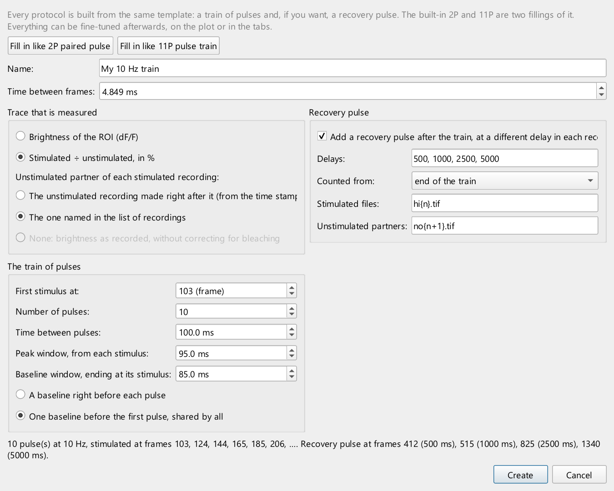
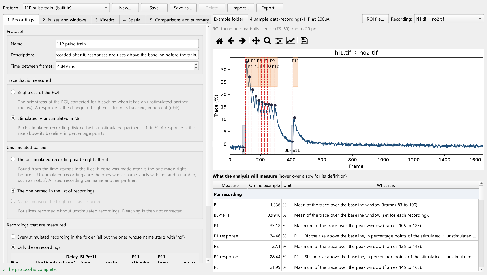
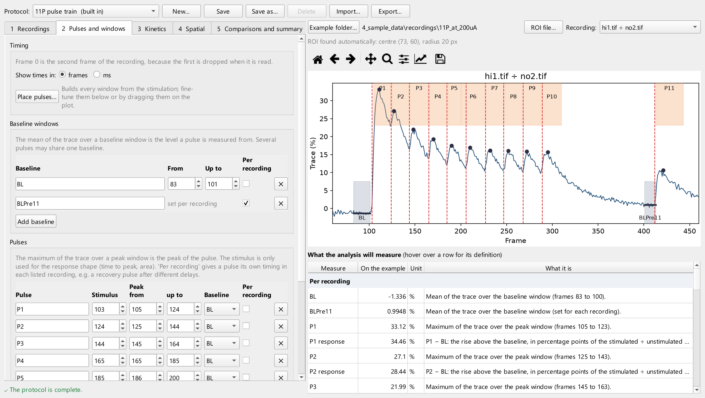
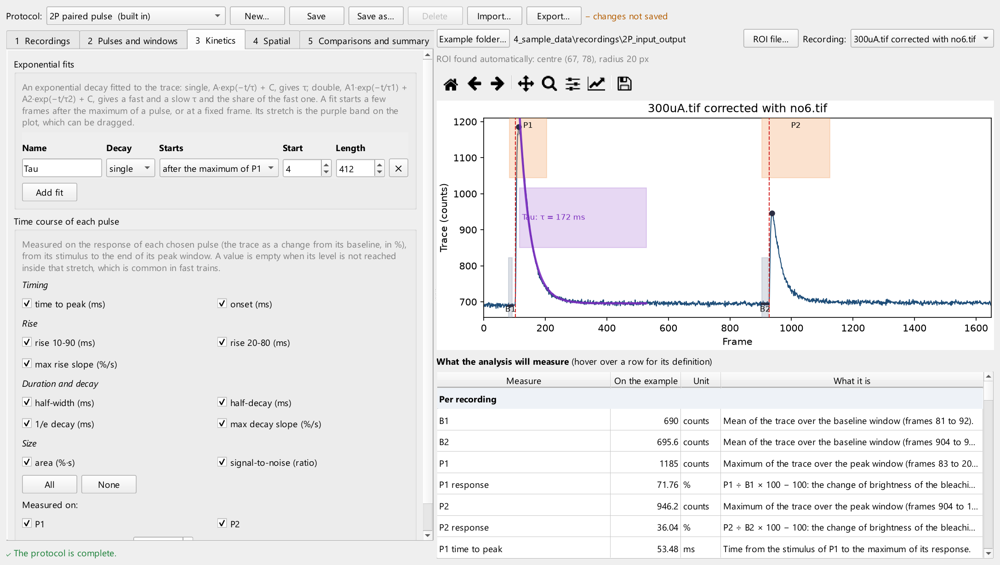
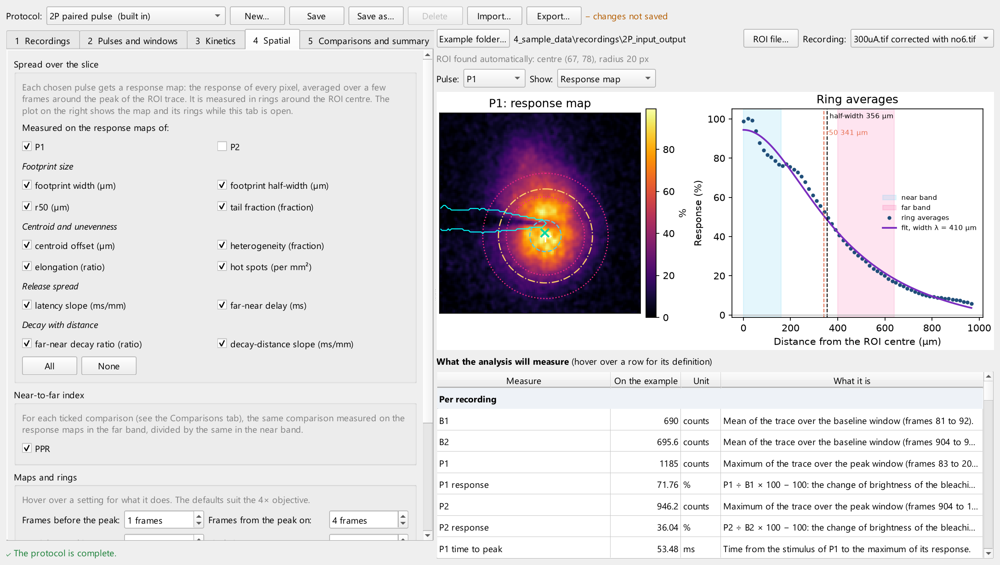
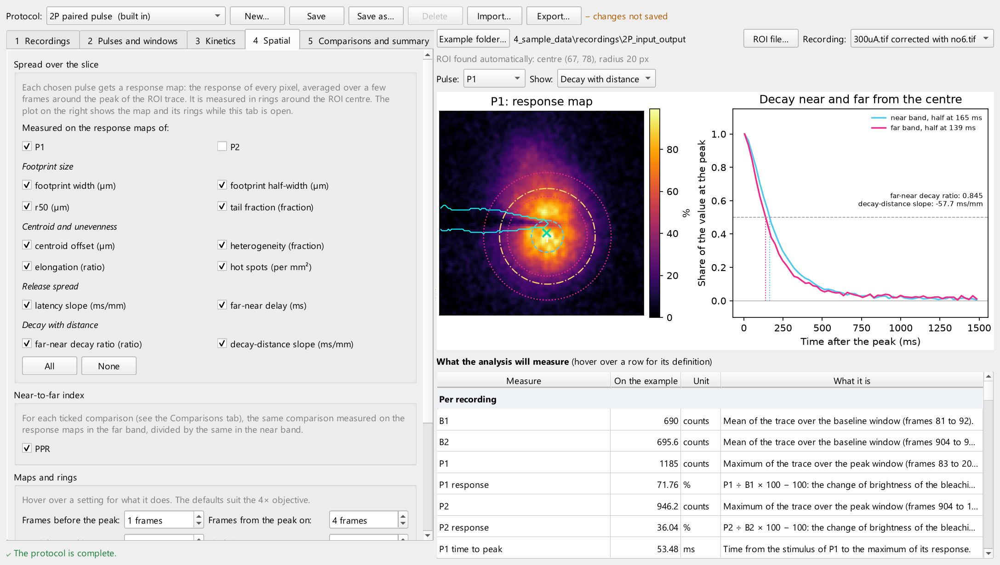

Step by step
============

1. Choose a protocol
--------------------

Choose *Evoked Analysis Configurator* in the start window. The bar at the
top of the window holds the protocol library:

.. list-table::
   :widths: 18 82

   * - Protocol
     - The protocols in the library: the built-in ones first, then your own.
   * - New…
     - Makes a new protocol from the template (see below). It is saved once
       you press *Save*.
   * - Save
     - Saves the changes. A built-in protocol asks for a new name instead.
       A protocol with a problem (listed under the tabs, in red) cannot be
       saved until the problem is fixed.
   * - Save as…
     - Saves a copy under a new name.
   * - Delete
     - Deletes one of your protocols. Built-in protocols cannot be deleted.
   * - Import… / Export…
     - Adds a protocol file to the library, or saves a copy of the protocol
       anywhere, for example to send it to a colleague.

*changes not saved* appears next to the buttons while there are unsaved
changes, and EMA asks before they are lost.

A new protocol: the template
----------------------------

Every protocol, the built-in 2P and 11P included, has the same parts: a train
of pulses and, if you want, a recovery pulse after it. *New…* asks for those
few numbers and builds the protocol from them.

   The template form, filled in like the 11P protocol.

* **Fill in like 2P / 11P** puts the timing of the built-in protocols into the
  form. (The built-in protocols themselves use hand-tuned windows.)
* **The train of pulses**: the frame of the first stimulus, the number of
  pulses and the time between them. Each peak window starts at its stimulus;
  each baseline window ends at its stimulus, or one baseline before the
  first pulse is shared by all.
* **Recovery pulse**: one more pulse after the train, at a different delay in
  each recording, counted from the end of the train (one interval after its
  last pulse) or from its last pulse. The recordings are listed with their
  delays, and the recovery windows are placed from each delay. The file names
  follow a pattern in which ``{n}`` is the recording's number.

The summary under the form gives the frame of every stimulus. Press *Create*,
then fine-tune the result on the plot or in the tabs.

2. Try it on a recording
------------------------

Press **Example folder…** and choose a folder of recordings, for example one
``input output`` folder. The protocol is tried on its recordings at once;
choose which one under *Recording*. The ROI is found automatically, as in
ROI Selection; press **ROI file…** to use the ROI saved by ROI Selection
instead. Nothing is ever written into the folder.

The plot shows the trace the protocol measures, with

* the **baseline windows** as grey bands in the bottom third, with the
  measured baseline as a dark line;
* the **exponential fits** as purple bands in the middle third, with the
  fitted curve in purple and τ written on the band;
* the **peak windows** as orange bands in the top third, with the measured
  peak as a dot;
* the **stimuli** as red dashed lines.

On the *Spatial* tab the plot shows the response maps instead (see below).

Under the plot, **What the analysis will measure** lists every number the
analysis will produce with this protocol: its name, its value on the
example recording, its unit, and its definition. Hover over a row to read
the whole definition. Values *per slice* combine all recordings of a folder,
so they are not shown for one example.

Use the zoom (magnifier) and pan (cross) buttons above the plot to look at
narrow windows, and the house button to see the whole trace again.

3. Recordings
-------------

   The *Recordings* tab of the 11P protocol.

Protocol
   Its name, a description, and the time between frames.

Trace that is measured
   * **Brightness of the ROI**: the mean brightness of the ROI, corrected
     for bleaching when the recording has an unstimulated partner. A
     response is the change of brightness from the baseline, in percent
     (dF/F).
   * **Stimulated ÷ unstimulated, in %**: each stimulated recording divided
     by its unstimulated partner, − 1, in %. A response is the rise above
     the baseline, in percentage points.

Unstimulated partner
   * **The unstimulated recording made right after it** (the default): found
     from the time stamps in the files. If none was made after it, the one
     made right before it. A listed recording can name another partner in
     its row.
   * **The one named in the list of recordings**: each listed recording
     names its partner. Needs a list of recordings.
   * **None**: the brightness as recorded, without correcting for
     bleaching, for slices recorded without unstimulated recordings. Not
     possible with a stimulated ÷ unstimulated trace.

   The *Recording* list above the plot names each recording's partner, for
   example ``300uA.tif corrected with no6.tif``. :doc:`measures` gives the
   formulas.

Recordings that are measured
   * **Every stimulated recording in the folder**: every recording whose
     name does not start with ``no``, except those with a word under *Skip
     names with* (such as ``red``). Their condition, for example the
     current, is the first number in the file name.
   * **Only these recordings**: a list. Each row gives a file, its
     unstimulated partner (left empty for the one made right after it), its
     condition (for example the delay of the recovery pulse), and the timing
     of any window that is set per recording. *Add recording* continues the
     numbering of the last row (``hi2.tif`` after ``hi1.tif``).

     With *Per-recording windows follow the condition* ticked, changing a
     recording's delay moves its own windows by the same time, so a recovery
     pulse stays in place.

4. Pulses and windows
---------------------

   The *Pulses and windows* tab of the 11P protocol, with the plot zoomed in
   on the train.

Baseline windows
   Each has a name and runs *from* a frame *up to* another (that one not
   included). Several pulses may share one baseline, as the train pulses
   share BL.

Pulses
   Each has a name, the frame of its **stimulus**, a **peak window** and the
   baseline it is measured from.

Per recording
   A baseline or pulse whose timing differs between recordings, such as a
   recovery pulse after different delays, is set *per recording*. Its
   timing is then given in each row of the list on the *Recordings* tab,
   and the plot shows (and lets you drag) its timing in the example
   recording. This needs a list of recordings.

Dragging on the plot
   Drag the edge of a band to move that edge, the inside of a band to move
   the whole band, and a red line to move a stimulus. Baselines are in the
   bottom third of the plot, fits in the middle third and peaks in the top
   third, so overlapping windows can still be told apart. Dragging a fit's
   band changes where it starts (counted from the maximum it follows) and
   how long it is. The values under the plot follow as you drag.

Show times in
   Frames or ms. Times are always stored as whole frames.

Place pulses…
   Builds the pulses and windows of a regular train from its first stimulus,
   the number of pulses and the time between them. Each peak window starts
   at its stimulus; each baseline ends at its stimulus, or one baseline
   before the first pulse is shared by all. It replaces the pulses and
   baselines of the protocol, except those set per recording; fine-tune the
   result in the tables or on the plot.

   .. figure:: ../screenshots/configurator_place_pulses.png
      :width: 60%

*Add pulse* adds a pulse one interval after the last, with the same timing
relative to its stimulus. When every pulse has a baseline of its own, the
new pulse gets one too.

5. Kinetics
-----------

   The *Kinetics* tab with every kinetic measure chosen. The purple band on
   the plot is the fit after P1.

Exponential fits
   A single fit, A·exp(−t/τ) + C, gives τ. A double fit,
   A1·exp(−t/τ1) + A2·exp(−t/τ2) + C, gives a fast and a slow τ and the share
   of the fast one. A fit starts a number of frames after the maximum of a
   pulse, or at a fixed frame, and lasts a number of frames.

Time course of each pulse
   Time to peak, onset, rise times, the steepest rise, half-width, decay
   times, the steepest fall, area and signal-to-noise, on the pulses ticked
   under *Measured on*.
   *All* and *None* tick or untick every measure. See :doc:`measures` for
   each definition.

6. Spatial
----------

   The *Spatial* tab. The plot shows the response map of P1 with the near
   band, far band, region and centroid, and its ring averages with the
   footprint fit.

Spread over the slice
   Footprint size, centroid and unevenness, release spread, and decay
   with distance, measured on the response maps of the pulses ticked above
   them.

Near-to-far index
   For each ticked comparison, the same comparison measured in the far band
   of the maps divided by the same in the near band.

Maps and rings
   How the maps are made and which distances the measures use. Hover over a
   setting for what it does.

While this tab is open, the plot shows the response map of the pulse chosen
above it, or its half-rise latency map, with the electrode outlined in cyan.
Next to it, *Show* chooses between the ring averages with the footprint fit
and the **decay with distance**: the near and the far band from the peak
on, each as a share of its value at the peak.

   The decay of P1 near and far from the centre, with the two measures of
   that group.

7. Comparisons and summary
--------------------------

Comparisons
   The response of one pulse divided by the response of another, as a ratio
   (0.5) or in percent (50 %). *Add every pulse relative to the first* adds
   one for every pulse.

Slice summary
   One value per slice from all its recordings: the minimum, maximum and
   mean of every measure, the mean over a range of conditions (for example
   100 to 400 µA), and how much each baseline varies between recordings.

Fits across conditions
   A curve fitted per slice to one measure against the condition of its
   recordings: *recovery* (for example P11/P1 against the delay, which gives
   the time constant of recovery) or *saturation* (for example the response
   against the current, which gives the half-max current). *Add fit across
   conditions* adds a recovery fit when the protocol has a pulse set per
   recording, and an input–output fit otherwise. See :doc:`measures` for
   the formulas and the rules.

   .. figure:: ../screenshots/configurator_summary.png
      :width: 100%

      The last tab of the 11P protocol, with a recovery fit of P11/P1 whose
      plateau is fixed at 100 %.

The line under the tabs says whether the protocol is complete. In red: what
must be fixed before it can be saved. In orange: what cannot be measured on
the example recording, for example a window after its end.
