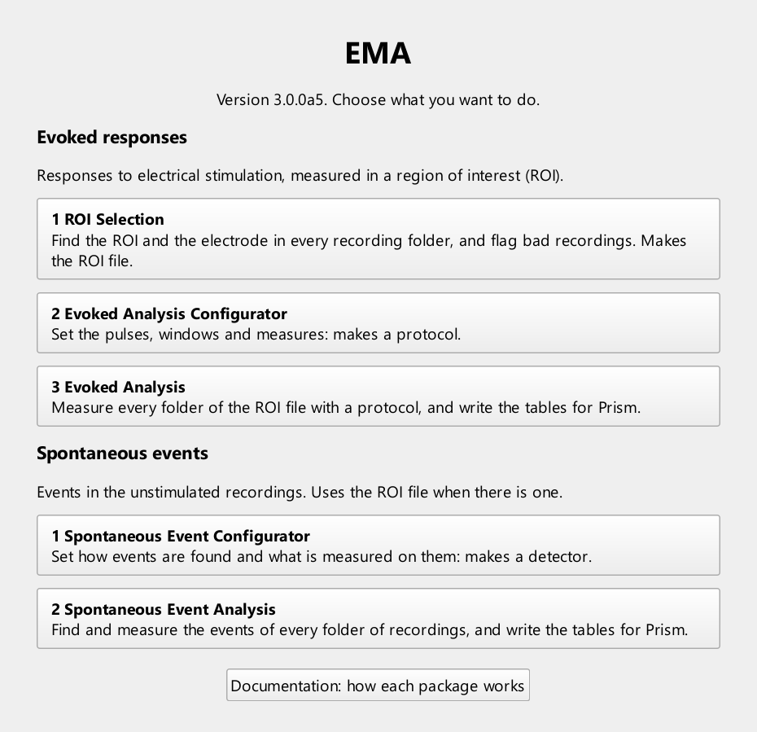

Getting started
===============

Install (once per computer)
---------------------------

You need two free programs, Python and Git, and then three lines typed in a
terminal. It takes about ten minutes.

1. **Python.** Download it from `python.org/downloads
   <https://www.python.org/downloads/>`_ (the big yellow button) and open the
   file you downloaded.

   * Windows: if the first screen of the installer has a box *Add python.exe
     to PATH*, tick it, then click *Install Now*. The first time you type
     ``py`` (step 3), Windows may offer to install Python itself: say yes.
   * Mac: click *Continue* and *Agree* until it is installed.

   Use the Python from python.org, not one from the Microsoft Store or from
   Homebrew.

2. **Git**, which downloads EMA and later its updates.

   * Windows: download *Git for Windows* from `git-scm.com/download/win
     <https://git-scm.com/download/win>`_, open it and click *Next* on every
     screen, then *Install*. The settings it suggests are fine.
   * Mac: open Terminal (see step 3), type ``git --version`` and press Enter.
     If Git is missing, the Mac offers to install the *command line developer
     tools*: click *Install*, and wait until it is done.

3. **EMA.** Open a terminal, a window where you type commands (Windows: press
   the Windows key, type ``cmd`` and press Enter; Mac: *Applications*,
   *Utilities*, *Terminal*). Type these three lines, one at a time, pressing
   Enter after each. On Windows:

   .. code-block:: bat

      git clone https://github.com/ecohen227/EMA.git
      cd EMA
      py install.py

   On a Mac, the last line is ``python3 install.py``.

   The first line downloads EMA into a folder called *EMA* in your home folder
   (``C:\Users\<you>\EMA``, or ``/Users/<you>/EMA`` on a Mac). The last line
   installs the packages EMA needs (a few minutes, with a lot of text scrolling
   by), builds this documentation and puts an *EMA* icon on the Desktop. It
   ends with *EMA is installed*.

To **update** EMA later, open a terminal and type ``cd EMA``, ``git pull``
and ``py install.py`` (Mac: ``python3 install.py``), one at a time. Your saved
protocols and detectors, your settings and your results are kept.

**Without Git**, on `github.com/ecohen227/EMA
<https://github.com/ecohen227/EMA>`_ click the green *Code* button, then
*Download ZIP*, and unzip it. Open a terminal in the unzipped folder (Windows:
click in the address bar of the folder's window, type ``cmd`` and press Enter;
Mac: in Terminal type ``cd`` and a space, drag the folder into the window and
press Enter), then type ``py install.py`` (Mac: ``python3 install.py``). To
update, download the ZIP again.

If something goes wrong
~~~~~~~~~~~~~~~~~~~~~~~

.. list-table::
   :header-rows: 1
   :widths: 40 60

   * - The terminal says
     - What to do
   * - ``'py' is not recognized`` (Windows) or ``command not found: python3``
       (Mac)
     - Python is not installed: do step 1, then close the terminal, open a new
       one and try again.
   * - ``'git' is not recognized`` or ``command not found: git``
     - Git is not installed: do step 2, then close the terminal, open a new
       one and try again.
   * - ``destination path 'EMA' already exists``
     - EMA is downloaded already. Type ``cd EMA``, then ``py install.py``
       (Mac: ``python3 install.py``).
   * - ``externally-managed-environment`` (Mac)
     - Your ``python3`` is not the one from python.org. Install Python from
       python.org (step 1), open a new Terminal and try again.
   * - ``The packages could not be installed``
     - Check the internet connection and type the last line again.
   * - ``Your local changes would be overwritten`` (when updating)
     - A file of EMA itself was changed. Type ``git stash``, then ``git pull``
       again.

Start EMA
---------

Double-click the **EMA** icon on the Desktop, or double-click ``EMA.pyw`` in
the EMA folder.

The start window lists the five packages under two headings, numbered in
the order you use them:

* **Evoked responses**: 1 ROI Selection, 2 Evoked Analysis Configurator,
  3 Evoked Analysis;
* **Spontaneous events**: 1 Spontaneous Event Configurator, 2 Spontaneous
  Event Analysis, which uses the ROI file of ROI Selection when there is
  one.

Click the one you need. The start window comes back when you close the
package. *Documentation* opens these pages.

   The start window.

:doc:`The workflow <index>` shows which file each package makes and which
it uses, and :doc:`recordings` says how your recordings should be named and
arranged.

Next: :doc:`quick_start`, your first analysis with the defaults.
