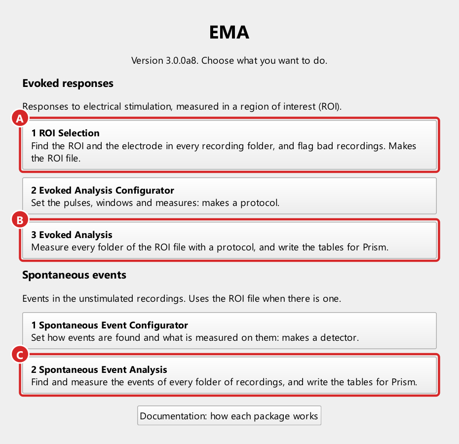
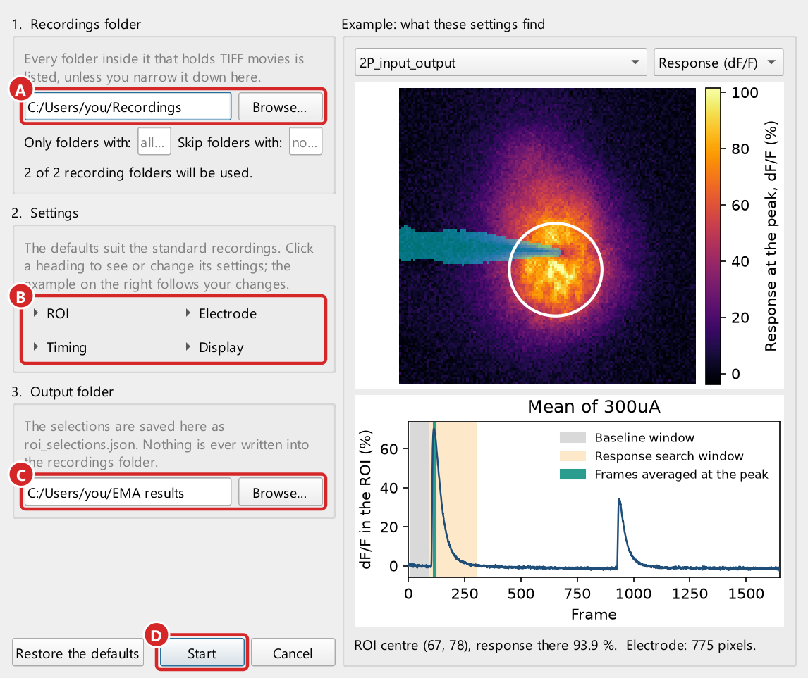
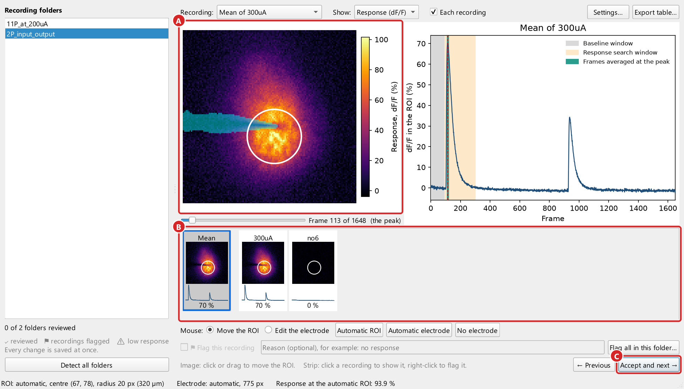
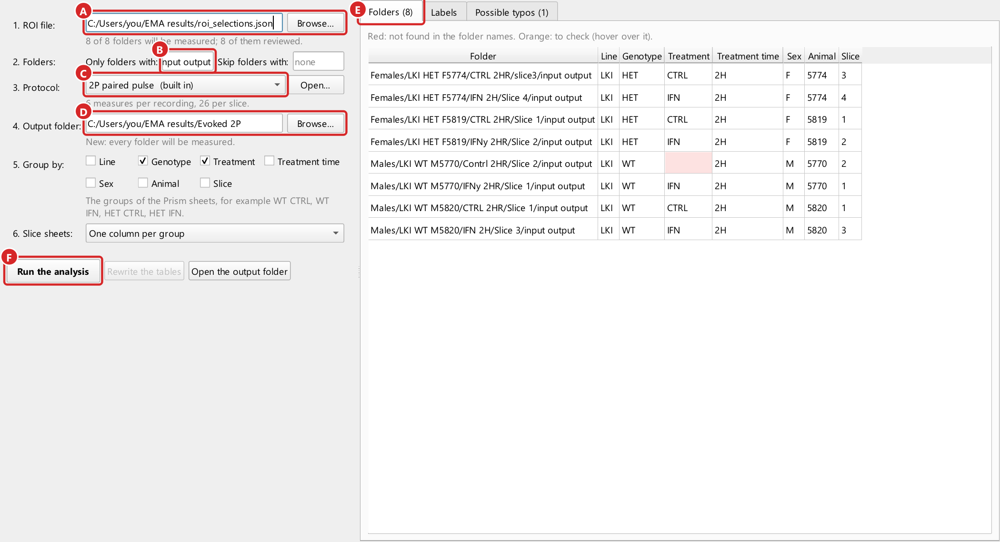
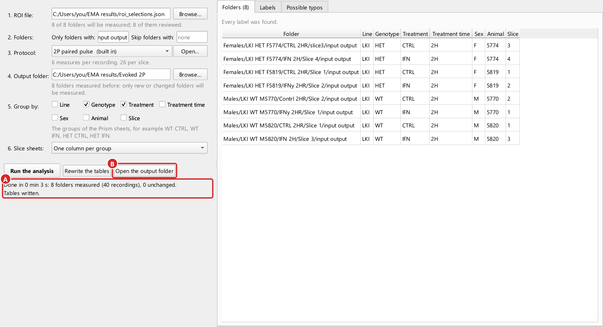
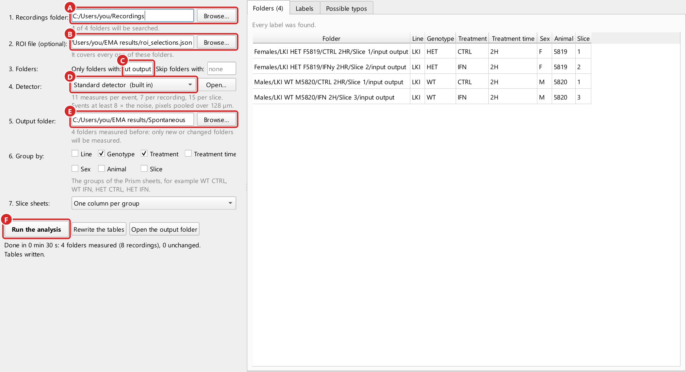

Quick start
===========

This page runs both analyses with EMA's defaults, without configuring
anything. It takes the built-in :term:`protocols <protocol>` and the
:term:`Standard detector`; you only choose folders and press buttons. The
red letters in the pictures match the letters in the text.

Before you start:

* EMA is installed (:doc:`getting_started`).
* Your recordings are arranged as :doc:`recordings` describes: one folder
  per slice and kind of recording (``input output``, ``11p``…), with the
  stimulated recordings named by their current (``100uA.tif``) and the
  unstimulated ones ``no1.tif``, ``no2.tif``…
* You have made an empty folder for the results, **outside** the
  recordings, for example ``EMA results`` on the Desktop. EMA only reads
  your recordings; everything it writes goes there.

   The start window. You need only **A** ROI Selection, **B** Evoked
   Analysis and **C** Spontaneous Event Analysis; the two configurators can
   be skipped.

Evoked responses
----------------

1. ROI Selection: where to measure
^^^^^^^^^^^^^^^^^^^^^^^^^^^^^^^^^^

In the start window, press **ROI Selection** (A).

   The setup window of ROI Selection.

* **A**: the recordings folder, the one that holds all your recording
  folders (**Browse…**).
* **B**: the settings; leave them as they are.
* **C**: the output folder, ``EMA results``.
* **D**: press **Start**.

Then go through the folders. Each opens with its ROI and electrode found
automatically:

   The ROI Selection window.

* **A**: the ROI (white circle) should sit on the response, and the
  electrode (cyan) should cover the electrode. If not, drag the ROI, or
  redraw the electrode (:doc:`roi_selection/walkthrough`).
* **B**: every recording of the folder. Right-click one that is bad (no
  response, a bubble…) to flag it; it will not be measured.
* **C**: press **Accept and next →**.

Everything is saved as you go, in ``EMA results/roi_selections.json``.
Close the window when you are done.

2. Evoked Analysis: the numbers
^^^^^^^^^^^^^^^^^^^^^^^^^^^^^^^

Skip the Evoked Analysis Configurator: three protocols are built in. In the
start window, press **Evoked Analysis** (B).

   The Evoked Analysis window, ready to run.

* **A**: the ROI file, ``EMA results/roi_selections.json``.
* **B**: *Only folders with* ``input output``, the paired-pulse folders.
* **C**: the protocol, *2P paired pulse*.
* **D**: a new output folder, ``EMA results/Evoked 2P``.
* **E**: check the **Folders** tab: each folder's genotype, treatment,
  animal and slice are read from its folder names. A red cell is one that
  was not found; see :doc:`evoked_analysis/labels` to fix it.
* **F**: press **Run the analysis**. If some folders were not reviewed in
  ROI Selection, EMA asks whether to leave them out.

   After the run.

* **A**: what was measured, and what was not (the *Notes* sheet of the
  Excel files says why).
* **B**: **Open the output folder**. It holds ``Evoked per recording.xlsx``
  and ``Evoked per slice.xlsx``. Each measure has a sheet laid out for
  :term:`Prism`, one column per group (WT CTRL, WT IFN, HET CTRL, HET IFN):
  copy from cell A4 to the last value and paste it into a Prism column
  table. See :doc:`evoked_analysis/tables`.

For the pulse trains, run it again with *Only folders with* ``11p``, the
protocol *11P pulse train* and the output folder ``EMA results/Evoked 11P``.

Spontaneous events
------------------

Skip the Spontaneous Event Configurator: the Standard detector is built in.
In the start window, press **Spontaneous Event Analysis** (C).

   The Spontaneous Event Analysis window, after a run.

* **A**: the recordings folder, the same as for ROI Selection.
* **B**: the ROI file, ``EMA results/roi_selections.json``, if you made
  one. It is optional: without it, each folder's electrode and ROI centre
  are found automatically.
* **C**: *Only folders with* ``input output``.
* **D**: the detector, *Standard detector*.
* **E**: a new output folder, ``EMA results/Spontaneous``.
* **F**: press **Run the analysis**. Each recording takes a few seconds;
  the line under the bar says how far it is, and **Stop** keeps every
  folder finished.

The output folder then holds ``Spontaneous per event.xlsx`` (one row per
event) and ``Spontaneous per slice.xlsx`` (one row per slice: event rate,
size, time course…). See :doc:`spontaneous_analysis/tables`.

Next time
---------

Run again with the same output folder after adding recordings: only new or
changed folders are measured, and the Excel files are written again.

When the defaults do not fit your recordings (another camera, other pulse
times, other folder names), the pages of each package say what to change.
