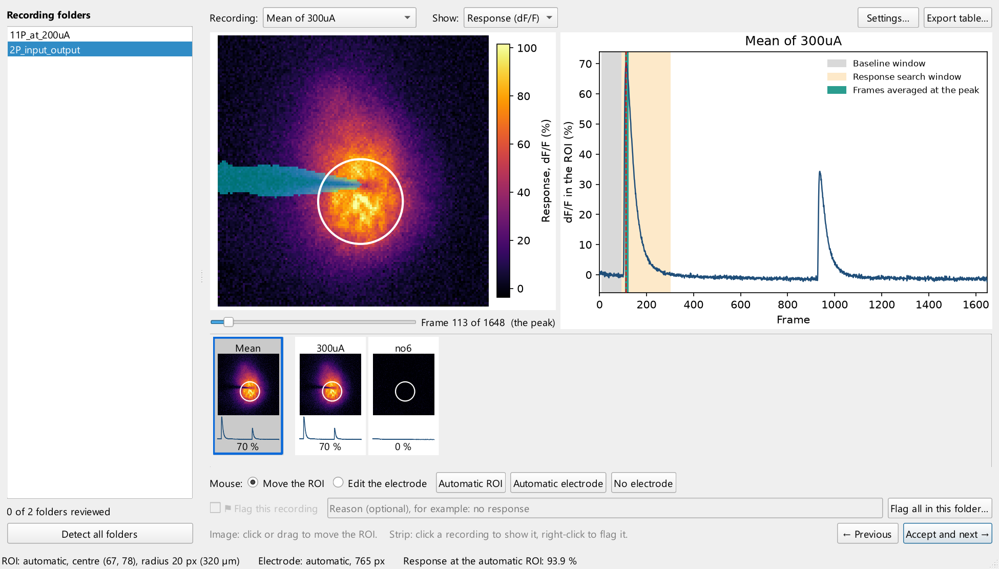

ROI Selection
=============

ROI Selection decides, for every recording folder, **where the response is
measured** (the ROI, a circle) and **which pixels are hidden by the
stimulating electrode** (the electrode mask). Both are found automatically.
You check each folder, correct what you disagree with, and flag recordings
that fail your criteria. The result is one file that the other EMA packages
read.

   The ROI Selection window. Left: the recording folders. Middle: the
   response map with the ROI (white circle) and the electrode mask (cyan).
   Right: the trace of the ROI. Below: every recording of the folder at a
   glance.

In short
--------

1. Choose *ROI Selection* in the start window.
2. Choose the recordings folder, check the settings, choose an output folder.
3. Go through the folders. For each one, look at the ROI and the electrode.
   Drag the ROI or redraw the electrode if needed. Look over the strip of
   recordings and right-click the ones that fail your criteria to flag them.
4. Press *Accept and next*.

Everything is saved as you go, in ``roi_selections.json`` in the output
folder. You can stop at any time and continue later.

.. toctree::
   :maxdepth: 2

   walkthrough
   procedure
   settings
   roi_file
