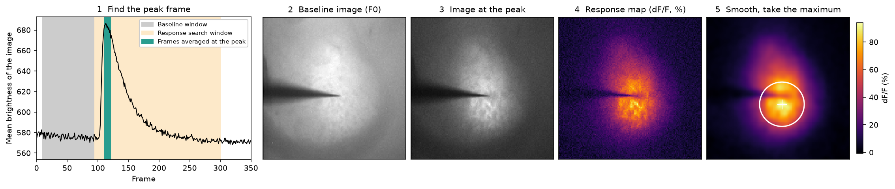
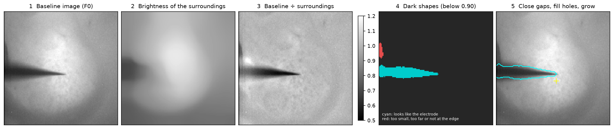

How the ROI and the electrode are found
=======================================

Both are found per recording folder, from the recordings with the clearest
response. By default these are ``200uA.tif`` and ``300uA.tif``. A folder
that has neither (an 11-pulse folder, for example) uses all its stimulated
recordings: every file whose name does not start with ``no``, except the
"red" movies.

Words in *italics* below are settings; :doc:`settings` describes each one.

The automatic ROI
-----------------

The ROI is a circle around **the pixel with the strongest response**.

   The five steps, on ``300uA.tif`` of the sample slice.

For each recording that sets the ROI:

1. **Find the peak frame.** The mean brightness of the whole image is
   followed through the *response search window*. The frame where it is
   highest (after a 5-frame running mean) is the peak frame.
2. **Baseline image.** The mean of the frames in the *baseline window* gives
   the resting brightness F0 of every pixel.
3. **Image at the peak.** The mean of a few frames around the peak: by
   default 2 before it and 8 from the peak on, about 50 ms in all.
4. **Response map.** Image at the peak ÷ baseline image − 1. This is dF/F
   for every pixel.

Then, for the folder:

5. **Average, smooth, take the maximum.** The response maps of the
   recordings are averaged. The mean map is blurred with a Gaussian
   (*smoothing*, 2 pixels) so that one noisy pixel cannot win. The brightest
   pixel of the result is the centre of the ROI. The ROI is the circle of
   the *ROI radius* around it.

The value of the smoothed map at that pixel is the *response at the
automatic ROI* shown in the status line. If it is below the *low-response
warning* (5 %), the folder gets a ⚠: with so little response, the brightest
pixel may just be noise.

Compared with earlier versions
~~~~~~~~~~~~~~~~~~~~~~~~~~~~~~

The metric study that preceded EMA 3 used the same idea: the maximum of the
smoothed mean of the peak dF/F maps. EMA 3 takes fewer steps to get there.
The study smoothed every frame of the movie in time and space before it
looked for the peak; EMA 3 averages the raw frames at the peak and smooths
once, at the end. On the two sample recordings the two methods agree to
within one pixel, and the new one is about 20 times faster. That is a check
on two recordings, not a validation on the whole study.

The study used 300 and 400 µA; EMA 3 uses 200 and 300 µA by default. This is
the setting *Recordings that set the ROI*.

The automatic electrode mask
----------------------------

The stimulating electrode is opaque. In the baseline image it is a dark
shape that comes in from one edge of the image and ends near the place of
release. The pixels under it say nothing about release, so later analysis
can leave them out.

   The five steps, on the sample slice. The yellow cross is the centre of
   the automatic ROI.

1. **Baseline image.** The mean baseline image of the recordings that set the ROI.
2. **Brightness of the surroundings.** For every pixel, the median
   brightness in a square around it (*size of the surroundings*, 31 pixels).
   The square is wider than the electrode, so the median is the brightness
   the tissue would have without it.
3. **Divide.** Baseline ÷ surroundings is close to 1 in tissue and well
   below 1 under the electrode, whatever the illumination.
4. **Keep the dark shape that looks like an electrode.** Pixels below the
   *darkness threshold* (0.90) form dark shapes. A shape is kept only if it

   * touches the image edge the *electrode enters from* (left),
   * has at least the *smallest area* (100 pixels),
   * is at least the *smallest length* long (30 pixels),
   * comes within the *greatest distance from the ROI* (40 pixels) of the
     centre of the automatic ROI.

   If several shapes pass, the largest is the electrode. If none passes,
   the folder starts without a mask.
5. **Tidy up.** Small gaps are closed, holes are filled, and the mask is
   widened (*grow the mask by*, 1 pixel) to cover the blurred rim of the
   electrode.

When the automatic result is wrong
----------------------------------

Automatic detection is a starting point. Typical cases to look out for:

* **The ROI sits on an edge or a corner, with a ⚠.** There was little or no
  response in the recordings that set the ROI. Check them; flag the folder
  if the slice did not respond.
* **No mask, although an electrode is visible.** Often the electrode is very
  wide where it enters the image, so its surroundings are dark too and the
  shape no longer reaches the edge. Draw the mask by hand, or raise *size of
  the surroundings*.
* **The mask spills along the image edge.** The edge of the image is darker
  than the middle. Remove the extra area with the right mouse button, or
  lower the *darkness threshold*.
* **The electrode comes from another side.** Set *electrode enters from*.

You can always overrule the result by hand; see :doc:`walkthrough`.
