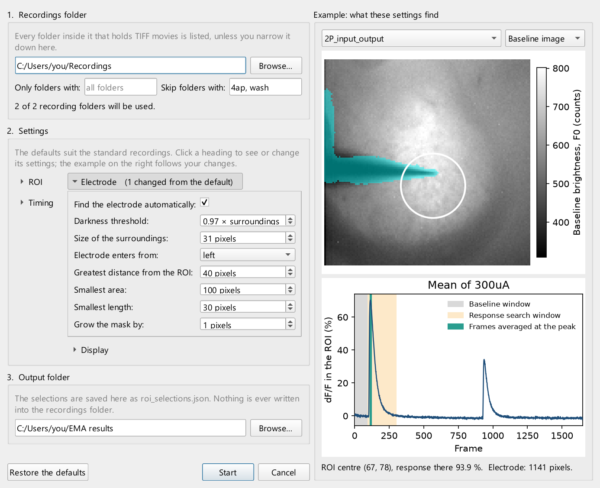
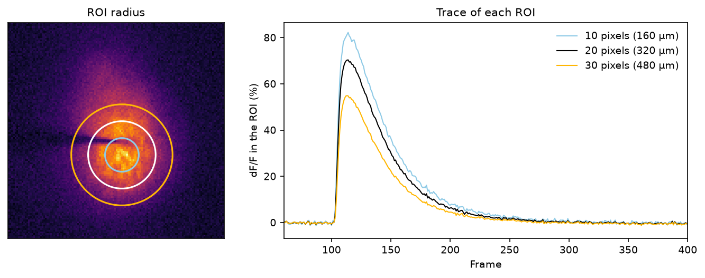
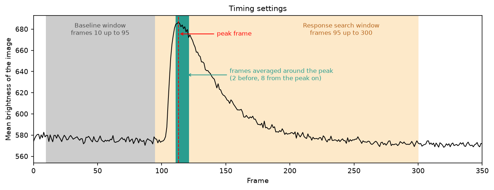
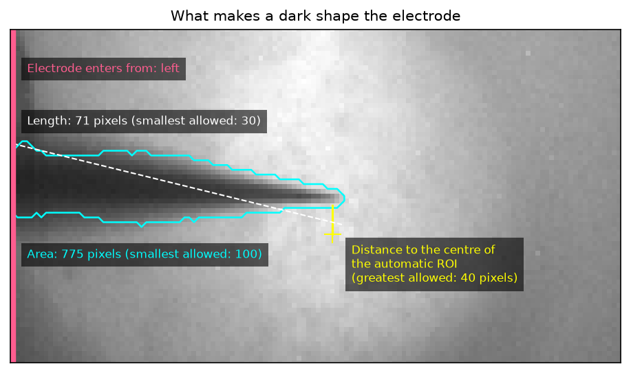
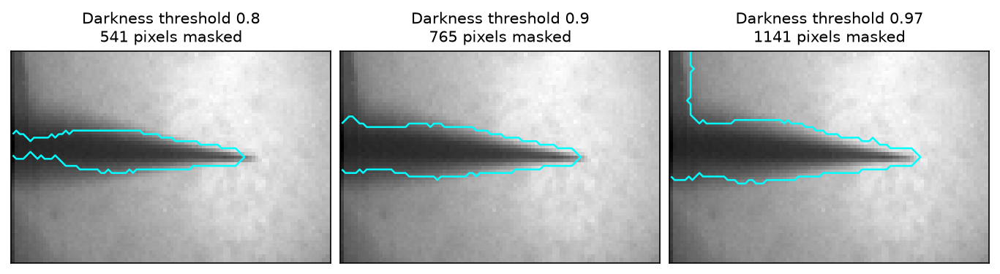
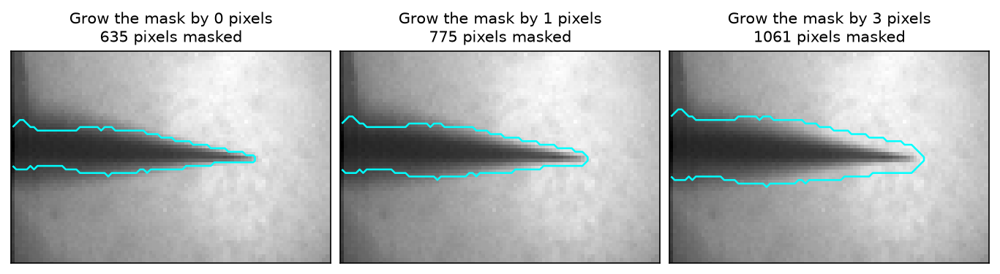

ROI Selection settings
======================

The settings are chosen in the setup dialog and can be changed later with
*Settings…*. They are saved in the ROI file together with the selections.
After a change, every folder has to be reviewed again.

In the dialog the settings sit in four sections, *ROI*, *Timing*,
*Electrode* and *Display*, which open when their heading is clicked. They
start closed; the defaults are set for 128 × 128-pixel recordings with the
stimulus near frame 103. The heading of a closed section says when one of
its settings is not at its default.

Trying a setting
----------------

The right half of the setup dialog is a live example. It runs the detection
on one of your own recording folders and redraws a moment after every change
to a setting: the ROI, the electrode mask, the trace of the ROI with the
timing windows, and one line with the numbers.

   Trying a higher darkness threshold, with the *Electrode* section open.
   The example shows the baseline image, where the electrode is easiest to
   see: the mask has grown along the image edge.

* The list above the image chooses the example folder. Try a folder with a
  strong response and one with a weak response.
* The second list switches between the response map (for the ROI settings)
  and the baseline image (for the electrode settings).
* Nothing is saved until you press *Start* or *Apply*.

All figures on this page are drawn from the sample slice by the program's
own functions. Distances are in pixels; with the 4× objective one pixel is
16 µm. Frame numbers count from the second frame of the TIFF (see
:doc:`../recordings`).

ROI
---

.. include:: ../_generated/settings_roi.rst

   **ROI radius.** A larger ROI averages over more tissue, including tissue
   that responds less, so its trace is lower. The default is 20 pixels
   (white).

.. figure:: ../figures/setting_smoothing.png
   :width: 90%

   **Smoothing.** Without smoothing the maximum is decided by single noisy
   pixels. With a lot of smoothing it moves towards the middle of the whole
   responding area. The cross is the maximum, the dotted circle the ROI.

.. figure:: ../figures/setting_low_response.png
   :width: 75%

   **Low-response warning.** The automatic ROI always lands somewhere. In a
   recording without a response it lands on noise (right), and the response
   there is small. Folders below the warning level are marked ⚠.

**Recordings that set the ROI** takes file names without ``.tif``, separated
by commas. They are averaged into the mean recording on which the ROI and
the electrode are found. If a folder has only some of them, those are used.
If it has none, all its stimulated recordings are used, except files with
one of the words under **Skip recordings with these words** in their name.

Timing
------

.. include:: ../_generated/settings_timing.rst

   **The timing settings** on the mean brightness of one recording. The
   baseline window must end before the stimulation. The search window must
   contain the peak of the first response; it may be generous, because only
   its highest point is used.

A :term:`window` is given as *from* a frame *up to* a frame; the second
frame itself is not included. If a recording is shorter than the start of a window, the
folder cannot be detected and the window says so.

Electrode
---------

.. include:: ../_generated/settings_electrode.rst

While *Find the electrode automatically* is switched off, the other
electrode settings are greyed out: they have nothing to act on.

   **What makes a dark shape the electrode.** It must touch the chosen image
   edge (pink), be long enough (dashed line: the diagonal of its bounding
   box), be large enough, and come close enough to the centre of the
   automatic ROI (yellow).

   **Darkness threshold.** A lower threshold keeps only the darkest core of
   the electrode. A higher one also takes in the dim tissue beside it and
   the dark image edge.

.. figure:: ../figures/setting_electrode_surround.png
   :width: 90%

   **Size of the surroundings.** If the square is not clearly wider than the
   electrode, the electrode counts as its own surroundings and is not found
   (left). A very large square also catches the darker image edge (right).

   **Grow the mask by.** Widens the finished mask on all sides.

Display
-------

.. include:: ../_generated/settings_display.rst
