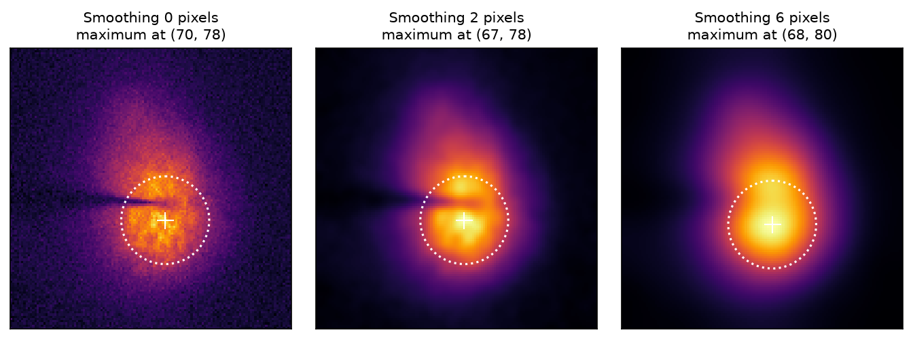
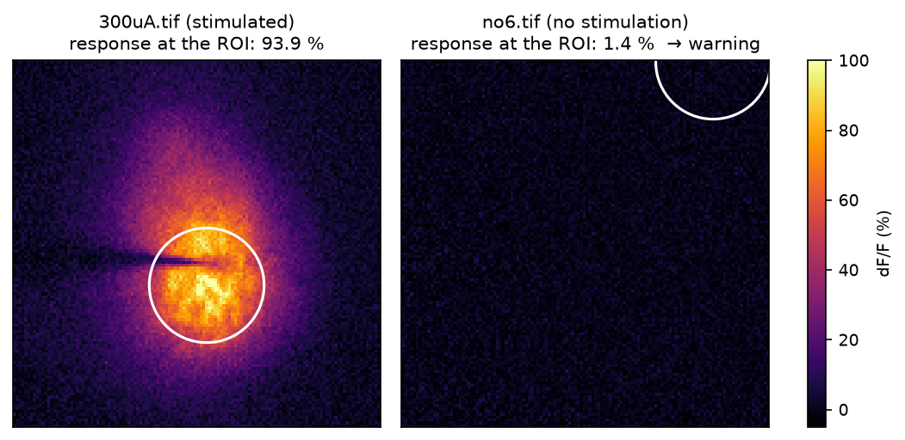
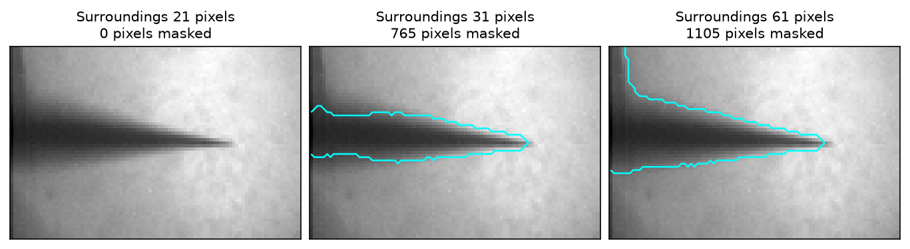

Settings
========

The settings are chosen in the setup dialog and can be changed later with
*Settings…*. They are saved in the ROI file together with the selections, so
it is always known which settings a selection was made with.

All figures on this page are drawn from the sample slice by the program's
own functions. Distances are in pixels; with the 4× objective one pixel is
16 µm. Frame numbers count from the second frame of the TIFF (see
:doc:`../getting_started`).

ROI
---

.. include:: ../_generated/settings_roi.rst

.. figure:: ../figures/setting_roi_radius.png
   :width: 90%

   **ROI radius.** A larger ROI averages over more tissue, including tissue
   that responds less, so its trace is lower. The default (white, 20 pixels)
   is the radius of all earlier EMA versions.

   **Smoothing.** Without smoothing the maximum is decided by single noisy
   pixels. With a lot of smoothing it moves towards the middle of the whole
   responding area. The cross is the maximum, the dotted circle the ROI.

   **Low-response warning.** The automatic ROI always lands somewhere. In a
   recording without a response it lands on noise (right), and the response
   there is small. Folders below the warning level are marked ⚠.

**Recordings that set the ROI** takes file names without ``.tif``, separated
by commas. If a folder has only some of them, those are used. If it has
none, all its stimulated recordings are used, except files with one of the
words under **Never use files named** in their name.

Timing
------

.. include:: ../_generated/settings_timing.rst

.. figure:: ../figures/setting_timing.png
   :width: 90%

   **The timing settings** on the mean brightness of one recording. The
   baseline window must end before the stimulation. The search window must
   contain the peak of the first response; it may be generous, because only
   its highest point is used.

A window is given as *from* a frame *up to* a frame; the second frame itself
is not included. If a recording is shorter than the start of a window, the
folder cannot be detected and the window says so.

Electrode
---------

.. include:: ../_generated/settings_electrode.rst

.. figure:: ../figures/setting_electrode_shape.png
   :width: 70%

   **What makes a dark shape the electrode.** It must touch the chosen image
   edge (pink), be long enough (dashed line: the diagonal of its bounding
   box), be large enough, and come close enough to the centre of the
   automatic ROI (yellow).

.. figure:: ../figures/setting_electrode_threshold.png
   :width: 90%

   **Darkness threshold.** A lower threshold keeps only the darkest core of
   the electrode. A higher one also takes in the dim tissue beside it and
   the dark image edge.

   **Size of the surroundings.** If the square is not clearly wider than the
   electrode, the electrode counts as its own surroundings and is not found
   (left). A very large square also catches the darker image edge (right).

.. figure:: ../figures/setting_electrode_grow.png
   :width: 90%

   **Grow the mask by.** Widens the finished mask on all sides.

Display
-------

.. include:: ../_generated/settings_display.rst
