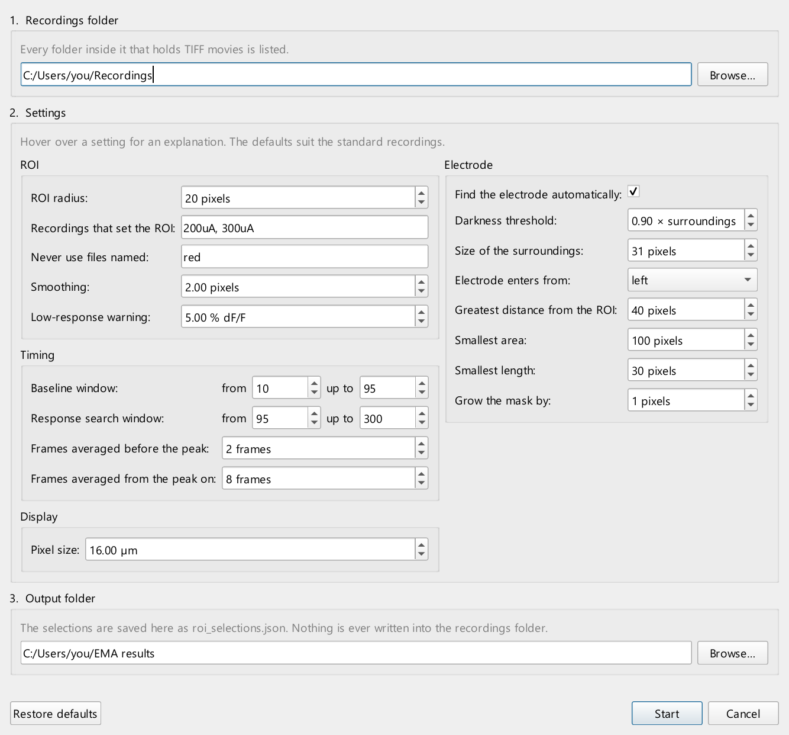
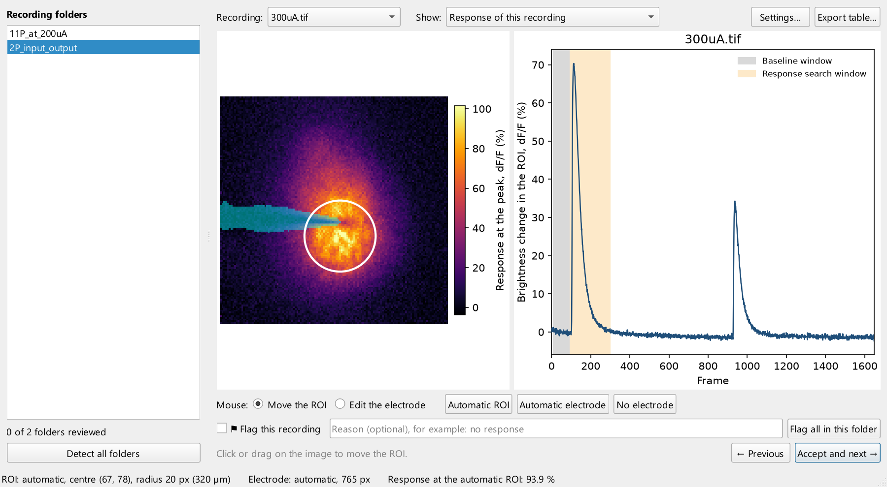
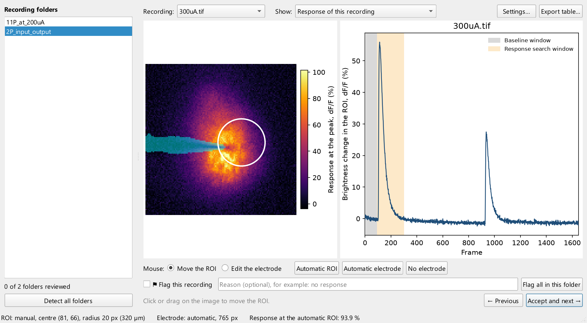
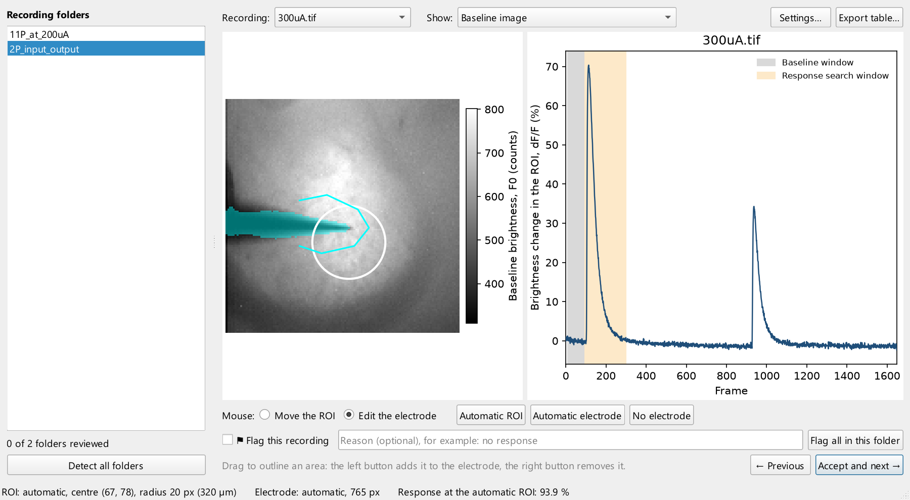
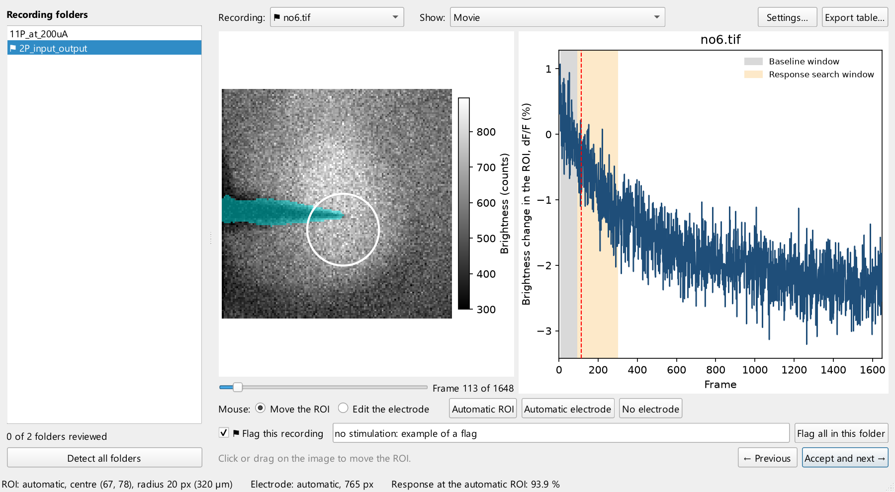

Step by step
============

1. Setup
--------

Choosing *ROI Selection* in the start window opens the setup dialog. It asks
three things, from top to bottom.

   The setup dialog.

Recordings folder
   The folder that holds your recordings. It can be one slice, one animal or
   a whole study: every folder inside it that holds TIFF movies is listed.

Settings
   The variables of the automatic detection. The defaults suit the standard
   recordings (128 × 128 pixels, stimulation near frame 103). Hover over a
   setting to read what it does; :doc:`settings` explains each one with a
   picture. *Restore defaults* puts every setting back.

Output folder
   Where ``roi_selections.json`` is saved. It must be outside the recordings
   folder, because EMA never writes into the recordings.

Press *Start*. EMA remembers both folders for next time.

2. The window
-------------

Recording folders (left)
   One line per recording folder. Click a folder to open it. The first time
   a folder is opened, EMA finds its ROI and electrode, which takes a second
   or two. The marks in front of a folder mean:

   .. list-table::
      :widths: 15 85

      * - grey name
        - Not detected yet.
      * - ✓
        - Reviewed: you pressed *Accept and next* on it.
      * - ⚑
        - At least one of its recordings is flagged.
      * - ⚠
        - Low response: check that the ROI is in a sensible place.

Recording (top)
   The drop-down list holds every recording of the open folder. The image
   and the trace show the recording chosen here. The ROI and the electrode
   mask belong to the folder, so they stay the same for all its recordings.

Show (top)
   What the image shows:

   * *Response of this recording*: the response map (dF/F at the peak) of
     the chosen recording.
   * *Mean response (used for the automatic ROI)*: the mean response map of
     the recordings that set the ROI.
   * *Baseline image*: the resting brightness, where the electrode is easiest to see.
   * *Movie*: the frames themselves, with a slider. A red line in the trace
     marks the frame on show.

Trace (right)
   The mean brightness inside the ROI as dF/F in percent, relative to the
   baseline window (grey). The orange band is the window in which the peak
   is looked for.

Status line (bottom)
   Where the ROI is, whether it and the electrode are automatic or manual,
   and the response at the automatic ROI.

3. Check and move the ROI
-------------------------

The ROI starts at the place of the strongest response (see :doc:`procedure`).
With *Move the ROI* selected, drag the circle, or click anywhere on the
image to centre it there. The trace follows while you drag. The ROI moves on
whole pixels and its centre cannot leave the image.

*Automatic ROI* puts the circle back where it was found.

   A moved ROI. The status line now says *ROI: manual*.

The size of the ROI is the same for every folder. Change it under
*Settings…* (*ROI radius*).

4. Check and redraw the electrode
---------------------------------

The cyan area is the electrode mask. Switch *Show* to *Baseline image* to
see the electrode itself.

To change the mask, select *Edit the electrode* and drag an outline on the
image:

* with the **left** mouse button, the outlined area is **added** to the mask;
* with the **right** mouse button, the outlined area is **removed** from it.

The outline closes itself when you release the button.

   Drawing an outline with the left mouse button…

.. figure:: ../screenshots/edit_electrode_done.png
   :width: 100%

   …adds that area to the mask. The status line now says *Electrode: manual*.

*No electrode* removes the mask, for a slice without an electrode in view or
to draw the mask from scratch. *Automatic electrode* puts back the mask that
was found automatically.

5. Flag recordings
------------------

Tick *Flag this recording* for a recording that fails your criteria, and
type a reason if you like. Flagged recordings get a ⚑ in the drop-down list,
and their folder gets one in the folder list. *Flag all in this folder*
flags every recording of the folder with the reason typed in the box.

A flag removes nothing. It is written to the ROI file, so that later
analysis can leave flagged recordings out.

   A flagged recording, shown as a movie.

6. Accept and go on
-------------------

*Accept and next* (or Ctrl+Enter) marks the folder as reviewed and opens the
next one. *Previous* goes back. The count under the folder list shows how
far you are.

There is no *Save* button: every change is saved at once.

Other things you can do
-----------------------

Detect all folders
   Finds the ROI and electrode of every folder that has none yet, with a
   progress bar. Useful before a break: afterwards the ⚠ marks show which
   folders need attention first.

Settings…
   Opens the settings again. After a change, folders you adjusted by hand
   keep their ROI and electrode (only the radius follows the new setting).
   All other folders are detected again with the new settings and lose
   their ✓, because what you reviewed has changed.

Export table…
   Saves one row per folder as a CSV file for Excel: ROI position, radius,
   whether it is automatic or manual, the size of the electrode mask, the
   response, and the flagged recordings.

Continue later
   Start ROI Selection again and choose the same output folder. The setup
   dialog shows the saved settings and says how many folders are already
   done.

Recordings on OneDrive
   Reading a file that is stored online only downloads it. EMA asks once
   before it does that. If you answer *No*, online-only recordings are
   skipped.
