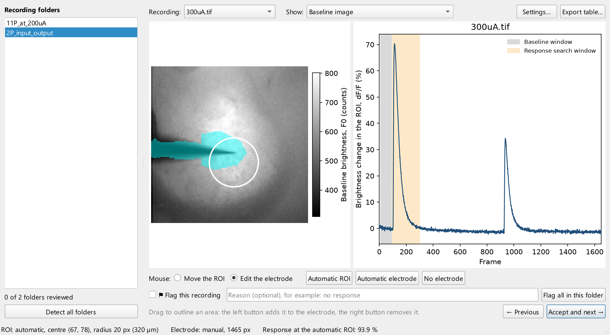
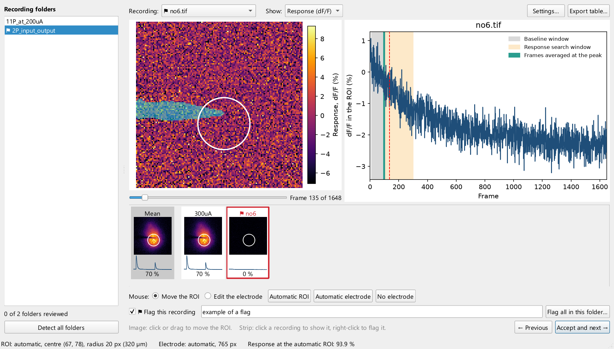

Step by step
============

1. Setup
--------

Choosing *ROI Selection* in the start window opens the setup dialog. It asks
three things, from top to bottom, and shows an example on the right.

.. figure:: ../screenshots/setup.png
   :width: 100%

   The setup dialog.

Recordings folder
   The folder that holds your recordings. It can be one slice, one animal or
   a whole study: every folder inside it that holds TIFF movies is listed.

Only folders with / Skip folders with
   To work on part of the recordings, type words that the path of a folder
   must or must not contain, separated by commas. Upper and lower case do
   not matter.

   * *Only folders with* ``11p`` keeps the 11-pulse folders; ``input`` keeps
     the input–output folders. With several words, one of them is enough.
   * *Skip folders with* ``4ap, wash`` leaves out every folder with one of
     these words anywhere in its path.

   The line below the boxes says how many folders will be used, and the
   example on the right only offers those. Folders that are left out are not
   listed in the window and do not appear in the ROI file. To keep, say,
   11-pulse and input–output selections apart, give each its own output
   folder.

Settings
   The variables of the automatic detection, in four sections: *ROI*,
   *Timing*, *Electrode* and *Display*. The sections are closed, because the
   defaults suit the standard recordings (128 × 128 pixels, stimulation near
   frame 103) and most of the time nothing here needs changing. Click a
   heading to open its section. Hover over a setting to read what it does;
   :doc:`settings` explains each one with a picture.

   A closed section says in its heading when something in it is not at its
   default, for example *Electrode (1 changed from the default)*, so a
   changed setting is never out of sight. *Restore defaults* puts every
   setting back.

Output folder
   Where ``roi_selections.json`` is saved. It must be outside the recordings
   folder, because EMA never writes into the recordings.

Example
   What the settings find in one of your recording folders: the automatic
   ROI (white circle), the electrode mask (cyan) and the trace of the ROI
   with the timing windows. It follows every change you make to a setting.
   Pick another folder in the list above the image, and switch between the
   response map and the baseline image next to it.

Press *Start*. EMA remembers both folders for next time.

2. The window
-------------

.. figure:: ../screenshots/window.png
   :width: 100%

Recording folders (left)
   One line per recording folder. Click a folder to open it. The first time
   a folder is opened, EMA finds its ROI and electrode, which takes a second
   or two. The marks in front of a folder mean:

   .. list-table::
      :widths: 15 85

      * - grey name
        - Not detected yet.
      * - ✓
        - Reviewed: you pressed *Accept and next* on it.
      * - ⚑
        - At least one of its recordings is flagged.
      * - ⚠
        - Low response: check that the ROI is in a sensible place.

Recording (top)
   What the image and the trace show. A folder opens on its **mean
   recording** (*Mean of 200uA, 300uA*): the average of the recordings that
   set the ROI. The automatic ROI and electrode were found on it, so it is
   the place to check them. Below it in the list are the recordings
   themselves. The ROI and the electrode mask belong to the folder, so they
   stay the same whichever recording is on show.

Show (top)
   What the image shows:

   * *Response (dF/F)*: the change in brightness relative to the baseline.
   * *Brightness*: the frames as they were recorded.
   * *Baseline image*: the resting brightness, where the electrode is
     easiest to see.

The slider (under the image)
   The frame on show. It starts at the peak of the response, and a red line
   in the trace marks it. Move it to watch the response rise and fade. The
   baseline image is an average over the baseline window, so the slider
   rests while it is on show.

Trace (right)
   The mean brightness inside the ROI as dF/F in percent, relative to the
   baseline window (grey). The orange band is the window in which the peak
   is looked for; the green band marks the frames averaged at the peak.

The strip (under the plots)
   Every recording of the folder at a glance; see step 5.

Status line (bottom)
   Where the ROI is, whether it and the electrode are automatic or manual,
   and the response at the automatic ROI.

3. Check and move the ROI
-------------------------

The ROI starts at the place of the strongest response (see :doc:`procedure`).
With *Move the ROI* selected, drag the circle, or click anywhere on the
image to centre it there. The trace follows while you drag, and the strip
follows when you let go. The ROI moves on whole pixels and its centre cannot
leave the image.

*Automatic ROI* puts the circle back where it was found.

.. figure:: ../screenshots/move_roi.png
   :width: 100%

   A moved ROI. The status line now says *ROI: manual*.

The size of the ROI is the same for every folder. Change it under
*Settings…* (*ROI radius*).

4. Check and redraw the electrode
---------------------------------

The cyan area is the electrode mask. Switch *Show* to *Baseline image* to
see the electrode itself.

To change the mask, select *Edit the electrode* and drag an outline on the
image:

* with the **left** mouse button, the outlined area is **added** to the mask;
* with the **right** mouse button, the outlined area is **removed** from it.

The outline closes itself when you release the button.

.. figure:: ../screenshots/edit_electrode_drawing.png
   :width: 100%

   Drawing an outline with the left mouse button…

   …adds that area to the mask. The status line now says *Electrode: manual*.

*No electrode* removes the mask, for a slice without an electrode in view or
to draw the mask from scratch. *Automatic electrode* puts back the mask that
was found automatically.

5. Review and flag the recordings
---------------------------------

The strip under the plots has one card per recording, after a first card
for the mean recording. Each card shows

* the response map at the peak, with the ROI on it,
* the trace of the ROI,
* the peak of that trace in percent.

All cards share one colour scale and one trace scale. A weak response looks
dim and flat next to a strong one, and an unstimulated recording looks
empty, so a recording that does not fit stands out without opening it.

* **Click** a card to show that recording in the plots above.
* **Right-click** a card to flag it, or to remove its flag. The recording
  is shown above and the cursor jumps to the reason box, so a reason can be
  typed straight away.

*Flag this recording* and the reason box next to it do the same for the
recording on show. *Flag all in this folder…* flags every recording of the
folder and asks for one reason for all of them.

Flagged recordings get a red frame in the strip and a ⚑ in the *Recording*
list, and their folder gets a ⚑ in the folder list. A flag removes nothing.
It is written to the ROI file, so that later analysis can leave flagged
recordings out. The mean recording cannot be flagged.

   A flagged recording. The slider has been moved past the peak.

The cards are filled one after another while the recordings are read, so
the window can be used straight away.

6. Accept and go on
-------------------

*Accept and next* (or Ctrl+Enter) marks the folder as reviewed and opens the
next one. *Previous* goes back. The count under the folder list shows how
far you are.

There is no *Save* button: every change is saved at once.

Other things you can do
-----------------------

Detect all folders
   Finds the ROI and electrode of every folder that has not been detected
   with the current settings, with a progress bar. Useful before a break: afterwards the ⚠ marks show which
   folders need attention first.

Settings…
   Opens the setup dialog again, with the open folder as the example.

   After a change to a **setting**, every folder has to be reviewed again:
   all ✓ marks are removed, and EMA asks before it does that. What you set
   by hand is kept, a moved ROI or a redrawn electrode; only the radius
   follows the new setting. Everything that was found automatically is found
   again with the new settings.

   A change to the **folder filter** does not undo any review. Folders that
   no longer pass the filter are removed from the ROI file, and EMA asks
   before it does that too.

Export table…
   Saves one row per folder as a CSV file for Excel: ROI position, radius,
   whether it is automatic or manual, the size of the electrode mask, the
   response, and the flagged recordings.

Continue later
   Start ROI Selection again and choose the same output folder. The setup
   dialog shows the saved settings and says how many folders are already
   done.
