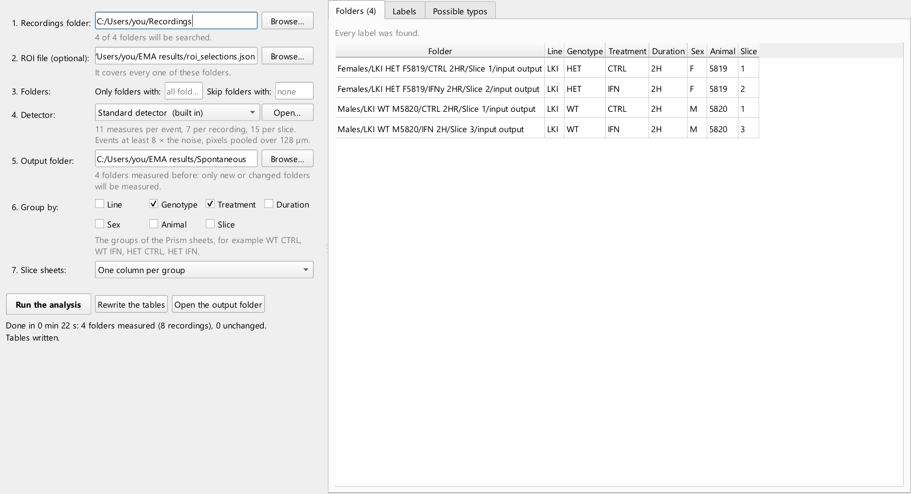

Spontaneous Event Analysis
==========================

The spontaneous-event analysis searches the
:term:`unstimulated recordings <unstimulated recording>` (``no1.tif``,
``no2.tif`` …) of every folder under a recordings folder with a
:term:`detector`, and writes two Excel files laid out for :term:`Prism`:
one row per event in the first, one row per :term:`slice` in the second.
Each row carries the :term:`labels <label>` read from its folder names,
such as the genotype and the treatment.

It needs

* a **recordings folder**: every folder in it that holds unstimulated
  recordings is searched;
* a **detector** made in the :doc:`Spontaneous Event Configurator
  <../spontaneous_configurator/index>`, or the built-in
  :term:`Standard detector`;
* an **output folder**, outside the recordings;
* optionally, the **ROI file** (``roi_selections.json``) that
  :doc:`ROI Selection <../roi_selection/index>` made for the same recordings
  folder, for its reviewed electrodes, :term:`ROI centres <ROI centre>` and
  :term:`flags <flag>`.

   The Spontaneous Event Analysis after a run on four made-up slices (the
   sample's unstimulated recording with events added to it). It is the
   window of the :doc:`Evoked Analysis <../evoked_analysis/index>`, with a
   recordings folder (the ROI file optional) and a detector in place of a
   protocol.

Step by step
------------

The window works like the Evoked Analysis's (see
:doc:`../evoked_analysis/index`):

1. **Recordings folder**. The line under it says how many of its folders
   will be searched. **ROI file**, optionally: the line under it says how
   many of those folders it covers. An ROI file made for another recordings
   folder is not used.
2. **Folders**: the folders to search, for example *Only folders with*
   ``input output``. Unstimulated recordings in the 11P folders can be
   searched too: run them as a separate analysis, or together, with a label
   that tells them apart.
3. **Detector**: one from the library, or **Open…** for a detector file kept
   elsewhere. The line under it says how many measures it reports, its
   event threshold and its pooling width.
4. **Output folder**: the line under it says what a run will do.
5. **Labels**: the same labels, spellings and possible typos as in the
   Evoked Analysis (see :doc:`../evoked_analysis/labels`); both analyses
   start with the labels last used in either.
6. **Group by** and **Slice sheets**: the groups of the Prism sheets.
7. **Run the analysis**. **Stop** stops after the recordings being searched;
   the folders finished so far are kept.

What is searched in each folder
-------------------------------

Each recording folder is one slice. Its unstimulated recordings, named
``no`` and a number, are searched, except those with one of the detector's
:term:`skip words` (``red``) and those flagged in the ROI file. Each is
searched as :doc:`../spontaneous_configurator/detector` describes, and every
measure is measured on every event
(:doc:`../spontaneous_configurator/measure_reference`). The per-slice
measures pool all searched recordings of the folder.

The detector leaves the electrode out of the searched tissue, and the place
measures are measured from the ROI centre. Each folder's electrode and ROI
centre come from:

.. list-table::
   :header-rows: 1
   :widths: 30 70

   * - *Electrode and centre*
     - Where they came from
   * - ``ROI file, reviewed`` / ``ROI file``
     - Its entry in the ROI file, reviewed in ROI Selection or not.
   * - ``automatic``
     - Found from the folder's stimulated recordings, as ROI Selection's
       automatic detection does with its default settings, when the ROI
       file does not cover the folder (or there is no ROI file).
   * - ``none``
     - The folder has no stimulated recording: it is searched without an
       electrode, and its place measures (distances, electrode side, share
       near the ROI centre) are empty.

The *Electrode and centre* column of the tables says which, and the *Notes*
sheet points out the automatic and the missing ones.

Searching takes time: about 9 s per recording on one processor core.
Several recordings are searched at once, one per core but one (at most 8),
each in a process of its own: on a 12-core laptop, about 3 s per recording,
or 4 hours for 4,500 recordings. Switching off *Count time-reversed events*
in the detector makes each search shorter.

Running again
-------------

As in the Evoked Analysis, everything is kept in the output folder, in
``spontaneous_analysis.json`` (the :term:`kept results`): the detector, the
labels, the groups, and every recording's and every event's measures. A new
run with the same output folder searches only what it has to:

.. list-table::
   :header-rows: 1
   :widths: 45 55

   * - Since the last run
     - What happens
   * - Nothing changed
     - Nothing is searched; the files are written again (in seconds).
   * - New folders under the recordings folder
     - Only the new folders are searched, and added to the files.
   * - A folder's ROI centre, electrode or flags in the ROI file changed
       (or the ROI file now covers it, or no longer does), or a recording
       was added, replaced or removed
     - That folder is searched again.
   * - A folder is no longer under the recordings folder (or in the folder
       filter)
     - EMA asks whether to keep its results.
   * - The labels, the groups, or which measures the detector reports
     - Nothing is searched: every measure is kept, so the files are only
       written again. Press **Rewrite the tables**, or run.
   * - The detector's settings or skip words changed, or a new version of
       EMA computes the results differently
     - Every folder is searched again, and both files are replaced. EMA
       asks first.

.. toctree::
   :maxdepth: 2

   tables
