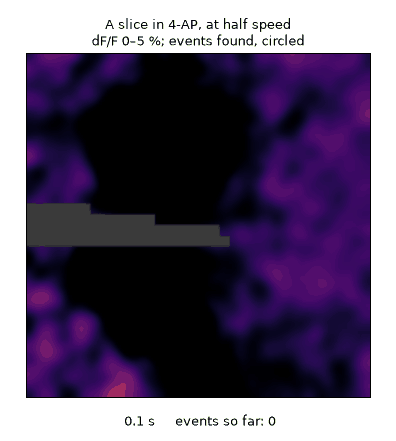
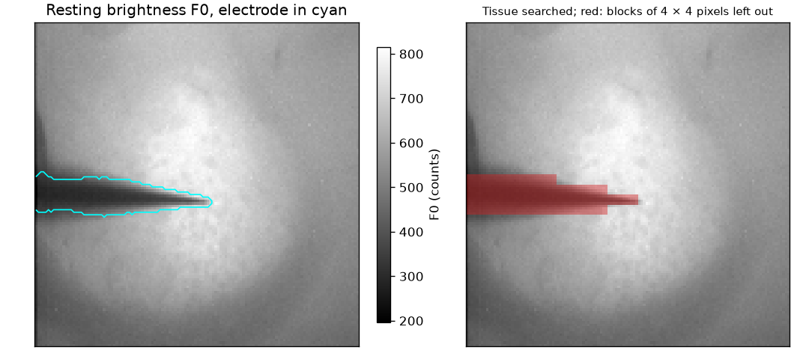
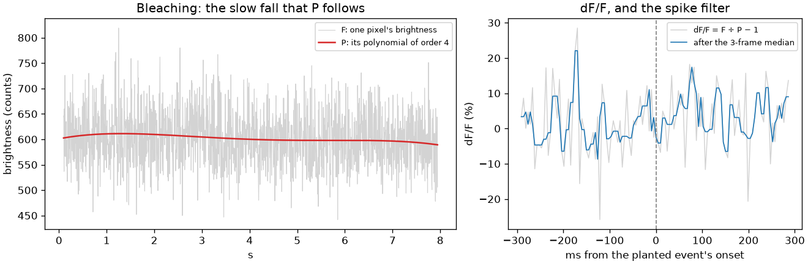
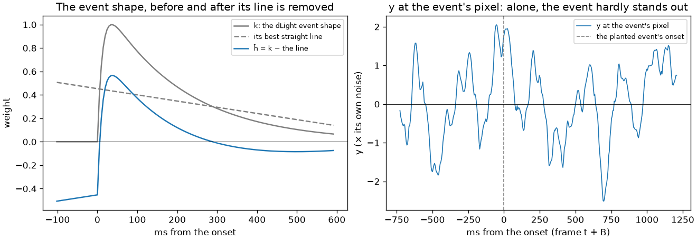
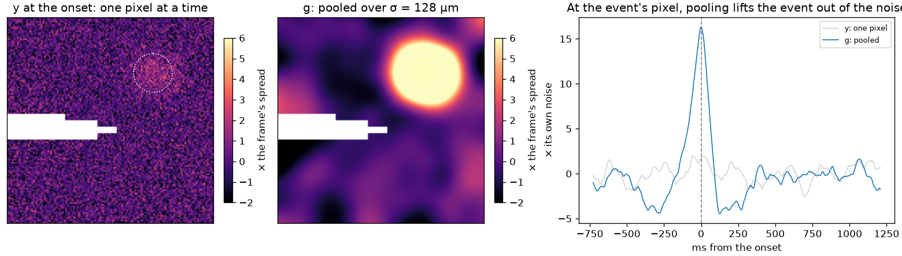
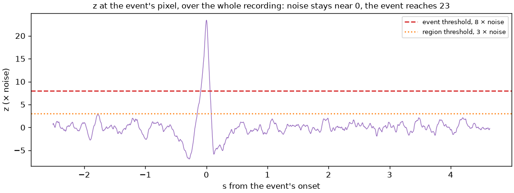
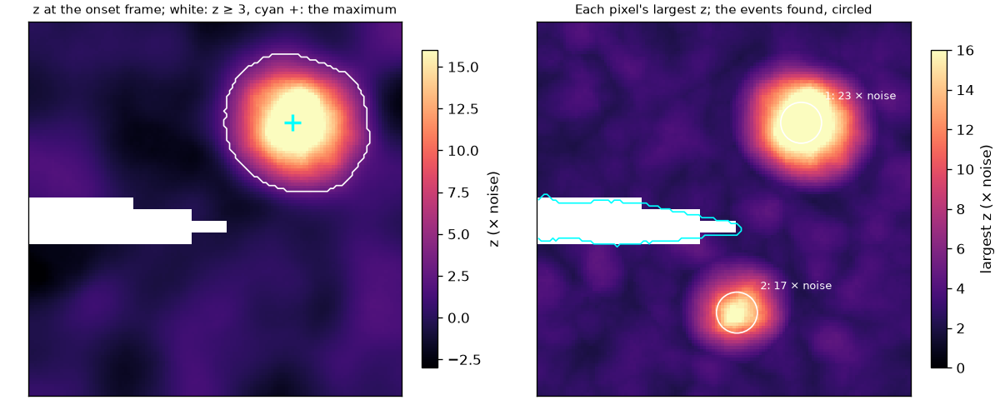
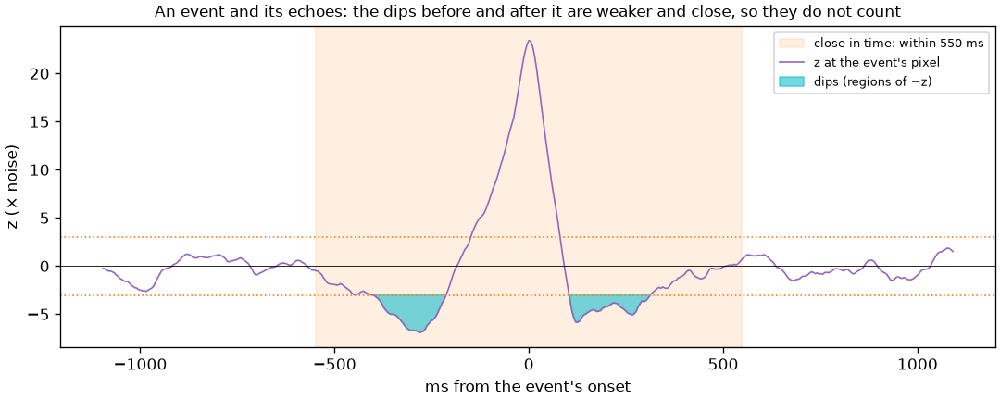

How the detector works
======================

What it looks for
-----------------

A typical spontaneous event peaks at about 3 % :term:`dF/F`, is about
150 µm wide, rises in about 30 ms and falls to half in about 100 ms. One
pixel's :term:`noise` is 4–6 % dF/F per frame, larger than the event. So
the detector does not look at single pixels and frames. It asks, at every
pixel and every frame, "does an event of the expected shape start here?",
pooling the answers of neighbouring frames (step 3) and neighbouring pixels
(step 4) before it decides.

   The Standard detector on a busy recording: a slice in 4-AP, a drug that
   makes release far more frequent, played at half speed. The colour is
   dF/F, blurred over 48 µm for the picture only. Each cyan circle marks an
   event from its onset for half a second of the recording; its radius is the pooling width,
   128 µm. The detector found 16 events in this recording; its controls
   found none sign-flipped and one time-reversed.

Each step below says first in words what it does, then exactly, as a
formula. The formulas can be skipped; they are there so that every number
EMA reports can be traced back. Every number is a setting (in *italics*;
see :doc:`settings`), given with its value in the :term:`Standard detector`.

The figures follow the Standard detector on the sample unstimulated
recording (``no6.tif`` of the 2P sample folder), with two events added to
it: a peak of 4 %, 150 µm wide, and a peak of 3 %, 120 µm wide, both with
the time course of a dLight event; the rest is the real recording.

Notation
--------

.. list-table::
   :widths: 18 82

   * - :math:`F_t(x)`
     - The brightness of pixel :math:`x` in frame :math:`t` of the part
       that is searched (step 0), :math:`t = 0, 1, \dots, T-1`.
   * - :math:`\Delta t`
     - The *Time between frames*: 4.849 ms.
   * - pixel
     - 16 µm wide (*Pixel size*).
   * - median, MAD
     - The middle value of a list; the *median absolute deviation* is the
       median of the distances to it, :math:`\mathrm{MAD} =
       \mathrm{median}\,|v - \mathrm{median}(v)|`. Both ignore a few
       extreme values, such as an event, where a mean and a standard
       deviation would be pulled by them. For random (normal) noise,
       :math:`1.4826 \times \mathrm{MAD}` equals the standard deviation.

The steps
---------

0. The part that is searched
^^^^^^^^^^^^^^^^^^^^^^^^^^^^

The first 20 frames (after the one EMA always drops) and the last 10 are
left out. For a recording of :math:`N` frames, :math:`T = N - 30` frames are
searched: 1,619 of a 1,650-frame TIFF.

1. Tissue
^^^^^^^^^

Only tissue is searched: not the electrode, and not the dark corners
outside the slice. The image is cut into blocks of 4 × 4 pixels (64 µm,
*Block size*), and each block is kept or left out as a whole.

Each pixel's resting brightness :term:`F0` is its mean over frames 10 to 94
of the recording (*Resting brightness window*). With :math:`\bar F_k` the
mean F0 of block :math:`k` and :math:`e_k` the share of its pixels under the
electrode, the block is searched when

.. math::

   \bar F_k > 0.3 \times \mathrm{median}_j\, \bar F_j
   \quad\text{and}\quad e_k < 0.5 .

0.3 is *Leave out blocks darker than*, 0.5 is *Leave out blocks under the
electrode from*. The electrode comes from the ROI file, or else is found
automatically from the folder's stimulated recordings. Below, :math:`M(x)`
is 1 for a pixel of a searched block and 0 otherwise.

   Left: the resting brightness, with the electrode. Right: in red, the
   blocks left out.

2. dF/F, bleaching and spikes
^^^^^^^^^^^^^^^^^^^^^^^^^^^^^

The light slowly bleaches the sensor, so the brightness drifts down over a
recording. Each pixel's brightness is therefore divided by a smooth curve
that follows the drift, which turns it into dF/F. Then single-frame camera
spikes are removed.

For each pixel, a polynomial of order 4 (*Bleaching correction order*) is
fitted to its brightness over time by least squares:

.. math::

   P_x(t) = \sum_{j=0}^{4} a_j(x)\, s_t^{\,j},
   \qquad s_t = -1 + \frac{2t}{T-1},
   \qquad a(x) \text{ minimises } \sum_t \bigl(F_t(x) - P_x(t)\bigr)^2 .

Then

.. math::

   \mathrm{dF/F}_t(x) = \frac{F_t(x)}{P_x(t)} - 1,
   \qquad
   d_t(x) = \mathrm{median}\bigl(\mathrm{dF/F}_{t-1}(x),\ \mathrm{dF/F}_t(x),\ \mathrm{dF/F}_{t+1}(x)\bigr),

a running median over 3 frames (*Spike filter*; the first and last frames
are kept as they are). Outside the tissue, :math:`d_t(x) = 0`.

   Left: one pixel's brightness and its polynomial. Right: its dF/F near
   the first planted event, before and after the spike filter. One pixel is
   noisier than the event (a peak of 4 %).

3. The time filter: the event shape
^^^^^^^^^^^^^^^^^^^^^^^^^^^^^^^^^^^

At every frame, the detector asks how well the next 600 ms of the trace
look like the start of an event. It does this by sliding the expected event
shape along each pixel's trace and multiplying point by point: where an
event starts, the trace and the shape rise and fall together and the sum is
large; elsewhere, noise gives as many negative products as positive ones.
This is a *matched filter*, the best way to find a signal of known shape in
random noise.

**The event shape.** A dLight event rises with a time constant of 12 ms
(*Rise time constant*) and decays with one of 200 ms (*Decay time
constant*):

.. math::

   k(\tau) = c\,\bigl(e^{-\tau/200\,\mathrm{ms}} - e^{-\tau/12\,\mathrm{ms}}\bigr)
   \ \text{ for } \tau > 0,
   \qquad k(\tau) = 0 \ \text{ for } \tau \le 0,

with :math:`c` such that its peak is 1. It is taken from 100 ms before the
onset (*Baseline before the onset*: :math:`B = 21` frames) to 600 ms after
it (*Length after the onset*: 123 frames), :math:`L = 144` frames in all:
:math:`k_j = k\bigl((j - B)\,\Delta t\bigr)` for :math:`j = 0, \dots, L-1`.

**Its best straight line.** The baseline under an event is rarely flat: the
bleaching correction is not perfect, and the tissue drifts. With *Allow a
sloping baseline*, the shape is made blind to any straight line. The *best
straight line* of the shape is the line :math:`\hat a + \hat b j` that comes
closest to it, in the least-squares sense:

.. math::

   (\hat a, \hat b) = \arg\min_{a,\,b} \sum_{j=0}^{L-1} \bigl(k_j - a - b\,j\bigr)^2 .

It is subtracted, and the result scaled to unit length:

.. math::

   \tilde h_j = k_j - \hat a - \hat b\, j,
   \qquad
   h_j = \frac{\tilde h_j}{\sqrt{\sum_i \tilde h_i^2}} .

What is left is orthogonal to every straight line:
:math:`\sum_j h_j = 0` and :math:`\sum_j j\, h_j = 0`. Adding an offset or a
steady slope :math:`a + b\,j` to a trace therefore does not change the
result below at all.

**The filter.** For every pixel and every frame :math:`t = 0, \dots, T-L`,

.. math::

   y_t(x) = \sum_{j=0}^{L-1} h_j\, d_{t+j}(x) .

:math:`y_t(x)` is about an event whose onset is frame :math:`t + B`.
Equivalently, fit the trace from :math:`t` to :math:`t + L - 1` with an event
of the expected shape on a straight baseline, :math:`d_{t+j} \approx A\,k_j
+ a + b\,j`, by least squares; then :math:`y_t = A \sqrt{\sum_i \tilde
h_i^2}`, a fixed multiple of the fitted amplitude :math:`A`. So :math:`y` is
the size of the event that best explains the trace at that moment, once any
straight baseline is allowed for. (Without *Allow a sloping baseline*,
:math:`h = k / \sqrt{\sum k_j^2}`, and no baseline is fitted.)

   Left: the event shape (grey), its best straight line (dashed), and the
   shape minus the line (blue), the filter :math:`\tilde h`. Right: the
   filtered trace :math:`y` of the pixel at the first planted event. One
   pixel is still too noisy: the event hardly stands out.

4. The spatial filter: pooling neighbouring pixels
^^^^^^^^^^^^^^^^^^^^^^^^^^^^^^^^^^^^^^^^^^^^^^^^^^

An event covers many pixels. Averaging neighbouring pixels keeps the event
and averages the noise away. Each frame of :math:`y` is blurred with a
:term:`Gaussian` whose width σ is the *Pooling width*, 128 µm (8 pixels),
about the width of a typical event. Only tissue is averaged, so the image
edges and the electrode do not pull the values down:

.. math::

   g_t(x) = \frac{\sum_{x'} G(x - x')\, M(x')\, y_t(x')}{\sum_{x'} G(x - x')\, M(x')},
   \qquad
   G(u) = e^{-|u|^2 / 2\sigma^2},

summed over the pixels :math:`x'` within :math:`3\sigma` of :math:`x`.

   The onset frame of the first planted event (dotted circle) before and
   after pooling, and the trace at its pixel: alone, one pixel reaches
   twice its noise; pooled, 16 times. The dips before and after the event
   come from the time filter (see step 8).

5. The field-wide signal
^^^^^^^^^^^^^^^^^^^^^^^^

Changes that the whole field shares, such as a flicker of the light, are
not events. With *Remove the field-wide signal*, each frame's median over
the tissue is subtracted:

.. math::

   g'_t(x) = g_t(x) - \mathrm{median}_{x' :\, M(x') = 1}\; g_t(x') .

6. Strength
^^^^^^^^^^^

How large :math:`g'` must be to be an event depends on how noisy that pixel
is. So each pixel's values are expressed in units of its own noise: the
:term:`strength` :math:`z`, in × noise. The middle and the spread are
measured with the median and the MAD, which events barely change:

.. math::

   z_t(x) = \frac{g'_t(x) - m(x)}{1.4826\ \mathrm{MAD}(x)},
   \qquad
   m(x) = \mathrm{median}_t\; g'_t(x),
   \qquad
   \mathrm{MAD}(x) = \mathrm{median}_t\, \bigl|g'_t(x) - m(x)\bigr| ,

both taken over every second frame (which is as good and twice as fast).
For pure noise, :math:`z` has a mean of 0 and a standard deviation of 1: a
value of 8 is eight times the noise.

   :math:`z` at the pixel of the first planted event, over the whole
   recording.

7. Regions and events
^^^^^^^^^^^^^^^^^^^^^

An event is a patch of high strength, in space and in time. Pixels and
frames with a strength of at least 3 × noise (*Region threshold*) that touch
each other form a :term:`region`: two of them touch when they are at most
one frame and one pixel apart in each direction (by a side, an edge or a
corner; 26 neighbours in all). For a region :math:`R`,

.. math::

   z^*_R = \max_{(t,\,x) \in R} z_t(x),

at the frame :math:`t^*` and pixel :math:`x^*` where the maximum is. The
region is an **event** when :math:`z^*_R \ge 8` (*Event threshold*). Its
position is :math:`x^*`; its onset is frame :math:`t^* + B` of the searched
part, frame :math:`t^* + B + 20` of the recording, at
:math:`(t^* + B + 20)\,\Delta t` from the start of the recording; its
strength is :math:`z^*_R`.

   Left: :math:`z` in the onset frame of the first planted event; the white
   line is the edge of its region in that frame, and the cross its
   maximum. Right: each pixel's largest :math:`z` over the recording, with
   the two events found.

8. Echoes
^^^^^^^^^

The time filter has negative parts (its weights add up to 0), so it turns
each event into a dip just before and just after it (figure of step 4,
right). These dips are not events. They matter for the sign-flipped control (below), which counts
dips, so they are dropped:

The regions of :math:`-z` (dips: :math:`z \le -3`) are found as in step 7.
Regions of either sign whose :math:`z^*` is below 5 are dropped first: they
are too weak to be an event or to remove one. Then a region :math:`p` is
dropped as an :term:`echo <echo>` of a region :math:`q` of the opposite sign
(*Drop echoes*) when all three hold:

.. math::

   |t^*_p - t^*_q| \le 113 \text{ frames } (550\ \mathrm{ms}),
   \qquad
   |x^*_p - x^*_q| \le 256\ \mathrm{\mu m},
   \qquad
   z^*_p \le 1 \times z^*_q ,

with 550 ms *Close in time within*, 256 µm *Close in place within* and 1 ×
*Stronger by at least*. Of an event and its echo, only the stronger counts.

   :math:`z` at the pixel of the first planted event. The dips before and
   after it are regions of :math:`-z` within 550 ms, weaker than the event:
   they are dropped.

9. The end of the recording
^^^^^^^^^^^^^^^^^^^^^^^^^^^

Onsets in the last 320 ms of the searched part (*Leave out onsets in the
last*, 66 frames) are not counted: there the event shape reaches the last
frames, where the bleaching correction is least certain.

The searched time
^^^^^^^^^^^^^^^^^

The :term:`searched time` is the time in which an onset can be counted:

.. math::

   S = (T - L + 1) - 66 \text{ frames},
   \qquad \text{time} = S\, \Delta t .

For a TIFF of 1,650 frames, :math:`T = 1{,}619` and
:math:`S = 1{,}619 - 144 + 1 - 66 = 1{,}410` frames, 6.84 s. Rates are
events per minute of searched time.

The controls
------------

Two controls run with every search; both are counted per recording.

**Sign-flipped.** The events of :math:`-z`: regions of :math:`z \le -3`
whose strongest value reaches :math:`-8`, with the same rules (step 8
applies to them too). Noise gives dimming events as often as brightening
ones; dopamine release does not. The :term:`sign-flipped` count therefore
estimates how many of the events are false alarms. It slightly
overestimates them, because real dimming and artefacts (bubbles, debris)
count too.

**Time-reversed.** The dF/F movie is played backwards,
:math:`d_t \to d_{T-1-t}`, and searched again from step 3. A real event,
with its fast rise and slow decay, looks wrong backwards and is mostly not
found; noise is found as often either way. A strong event can still be
found backwards. This second search makes each recording take longer;
switch *Count time-reversed events* off to save the time.

What the detector measures
--------------------------

The spatial filter finds events; it does not measure them. Each event is
measured afterwards on the dF/F movie :math:`d` of step 2:

* its **width and fitted peak** from a Gaussian fitted to its
  :term:`peak map`;
* its **time course** (rise, half-decay and more) from its
  :term:`pooled trace`, whose peak is lowered by the pooling. Use the
  fitted peak for amplitude.

:doc:`measure_reference` gives every measure in full.

Changing the pooling width and the event threshold
--------------------------------------------------

A larger *Pooling width* finds wide, faint events better; a smaller one
finds narrow events. A lower *Event threshold* finds more events, and more
false ones: compare the sign-flipped count.
