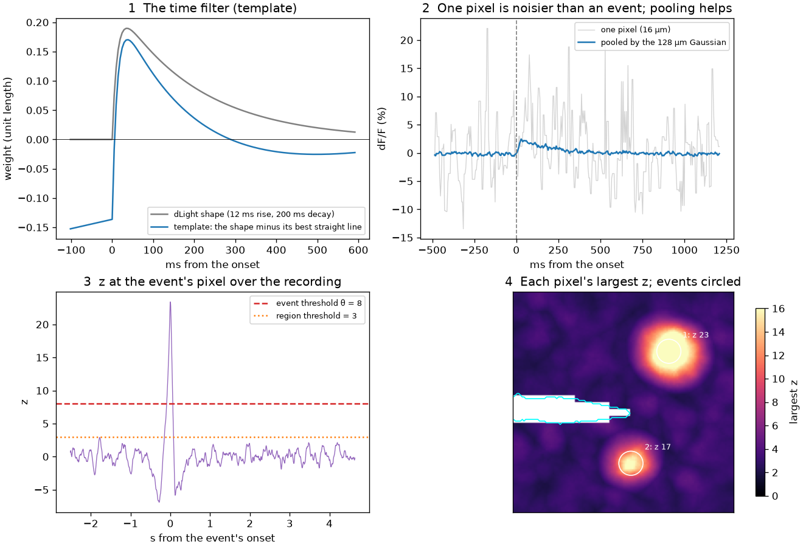

How the detector works
======================

The problem
-----------

A spontaneous dopamine event is small and brief: in the study, its peak is
about 3 % dF/F, it is about 150 µm wide (σ), rises in about 30 ms and falls
to half in about 100 ms. One 16 µm pixel's noise is 4–6 % dF/F per frame,
larger than a typical event. No detector can see a typical event in one
pixel; it has to pool pixels in space and frames in time. The noise is
spatially white (neighbouring pixels are not correlated), so the best
filter is the event's own shape: a **matched filter**, in space and in time.

   The detector on the sample unstimulated recording (``no6.tif`` of the 2P
   sample folder), with two events planted in it (4 % peak, σ 150 µm, and
   3 %, σ 120 µm, with the dLight time course; the rest is the real
   recording). **1** The template, before and after its best straight line
   is removed. **2** One pixel's dF/F at the first event, and the same
   pooled by the 128 µm Gaussian. **3** z at the event's pixel: the event
   reaches 23; the dips just before and after it are the template's echoes.
   **4** Each pixel's largest z over the recording, with both events found.

The steps
---------

Every number below is a setting (see :doc:`settings`); the values are
detector v5's.

0. **The recording.** The first 20 frames (after the one EMA always drops)
   and the last 10 are left out.
1. **Tissue.** Each pixel's resting brightness F0 is its mean over frames 10
   to 94. In 4 × 4-pixel blocks (64 µm), a block is tissue unless its F0 is
   below 0.3 × the median block's, or at least half of it lies under the
   electrode (the folder's electrode mask: from the ROI file, or else found
   automatically from its stimulated recordings). Only tissue is searched.
2. **dF/F and spikes.** Each pixel's brightness is divided by a polynomial
   of order 4 fitted to it over time (bleaching): dF/F = F ÷ fit − 1. A
   running median over 3 frames removes single-frame camera spikes.
3. **Time filter.** The template is the dLight shape
   exp(−t/200 ms) − exp(−t/12 ms), from 100 ms before the onset (21 frames)
   to 600 ms after it (123 frames), minus its best straight line, scaled to
   unit length. Sliding it along each pixel's trace gives, at every frame,
   the best fit of an event starting there together with a sloping baseline
   (Clements & Bekkers 1997, with a slope added). The slope matters: without
   it, a bright event bends its own pixels' bleaching fit, which inflates
   their noise and caps their z near 10 whatever the event's size.
4. **Space filter.** Each filtered frame is blurred with a Gaussian of
   σ = 128 µm over the tissue only (a normalised convolution: tissue edges
   and the electrode do not pull values down), about a typical event's width.
5. **Field-wide signal.** Each frame's median over the tissue is subtracted.
   After filtering, event pixels stand far out of the noise, so the median
   ignores them; at single pixels it would not.
6. **z.** Pixel by pixel, z = (output − its median) ÷ (1.4826 × its median
   absolute deviation), both over every second frame (the output is smooth
   in time). 1.4826 × the median absolute deviation is the standard
   deviation for Gaussian noise, but is not inflated by events.
7. **Regions.** Neighbouring pixels and frames (through faces, edges and
   corners) with z ≥ 3 form regions. A region whose largest z reaches θ = 8
   is an event, placed at that maximum: its onset is that frame's template
   onset. Counting regions of z ≥ 3 counts each event once; counting at θ
   itself would split strong events into islands.
8. **Echoes.** The template's response to an event has two negative echoes:
   0.35 s before it, at up to 26 % of its peak, and 0.13 s after, at up to
   53 %. So of two regions of opposite sign whose onsets are within 0.53 s
   and whose maxima are within 256 µm, only the stronger counts. The rule
   applies to both signs, so the sign-flip control stays fair. Regions
   weaker than z 5 neither count nor veto.
9. **End trim.** Onsets in the last 0.32 s of the searched range are not
   counted: there the template reaches the last frames, where each pixel's
   bleaching fit is least constrained, and detections of both signs pile up.

The **searched time** is what remains for onsets: the frames left after step
0, minus the template's length plus one, minus the end trim. For a
1,650-frame recording that is 1,410 frames, 6.84 s.

The controls
------------

Two controls run with every search; both are counted per recording.

**Sign-flipped.** The same z movie is searched for dips (−z) with the same
rules. Noise produces dips as often as rises; events do not. The
sign-flipped count estimates the false positives. It slightly overestimates
them, since real negative transients and artefacts (bubbles, debris) count
too. In the study: 7 % of events.

**Time-reversed.** The dF/F movie is played backwards and searched again.
A real event (fast rise, slow decay) looks wrong backwards and is mostly
not found; noise does not care. In the study: 42 time-reversed detections
against 1,236 events.

A third control of the study, **planted events**, is not part of the
configurator. Gaussian events of known size are added to real recordings
to measure how many are found. In the study, with this detector, events of
σ 96 µm were found at 0.4 %, 46 %, 98 % and 99.7 % for peaks of 1, 2, 4 and
8 % dF/F. Wide events (σ 128 µm and more) are found reliably from about 2 %
peak.

What the detector measures, and what it does not
------------------------------------------------

The 128 µm Gaussian is a detection filter, not a measurement. Each event is
measured afterwards, on the dF/F movie:

* its **width and fitted peak** from a Gaussian fitted to its peak map;
* its **time course** (rise, half-decay and more) from its trace pooled by
  the detector's spatial filter, whose peak is diluted. Use the fitted peak
  for amplitude.

:doc:`measure_reference` gives every measure in full.

Choosing the filter width and θ
-------------------------------

The study compared Gaussians of σ 16, 32, 64 and 128 µm, the best of
several at once, the old 64 µm squares, and no pooling at all, each at the
lowest θ where sign-flipped detections are at most 5 % of events:

.. list-table::
   :header-rows: 1
   :widths: 30 10 15 45

   * - Filter
     - θ
     - Events per min
     - 50 % found at σ 64 / 128 / 256 µm (peak dF/F)
   * - Gaussian 128 µm (*Detector v5*)
     - 8
     - 6.75
     - 3.6 / 1.6 / 0.91 %
   * - Gaussian 64 µm
     - 8
     - 5.33
     - 2.9 / 1.7 / 1.4 %
   * - Gaussian 32 µm
     - 8
     - 3.27
     - 3.1 / 2.7 / 2.3 %
   * - No pooling (a minimum area per frame)
     - 2.5
     - 0.99
     - 7.6 / 5.9 / 5.8 %

The gain comes from pooling in space. Of the events found by the 16, 32 and
64 µm filters, the 128 µm filter finds almost all (28 of 29, 44 of 46, 73 of
75), so it hides no population of small events. A lower θ finds more events
but more false ones too: θ 6 gives 1,997 events (12 % sign-flipped), θ 10
gives 910 (5.5 %).
