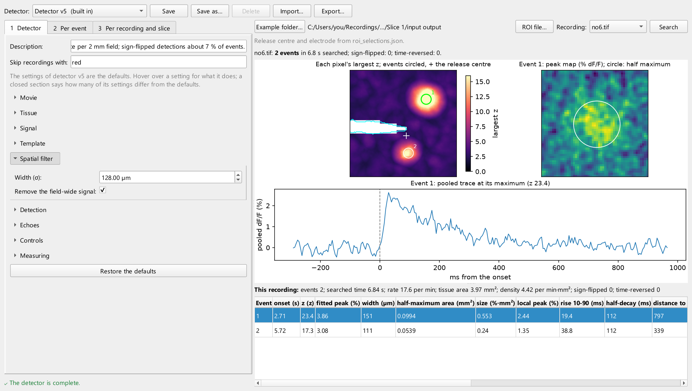

Spontaneous Event Configurator
==============================

The configurator makes **detectors**. A detector tells the spontaneous-event
analysis how to find spontaneous dopamine events in unstimulated recordings
(``no1.tif``, ``no2.tif`` …), and what to measure on them: per event, per
recording and per slice. Detectors are saved in a library inside EMA, like
the evoked protocols, so the analysis can use them by name.

The detector is **detector v5** of the metric study (13–14 November 2026),
with every number of it a setting. It is tried live on an example recording:
the events it finds are circled on the slice, and each one's peak map,
pooled trace and measures are shown.

   The configurator with the built-in *Detector v5*, on the sample
   unstimulated recording with two events planted in it (see
   :doc:`detector`). Left: the detector, in three tabs. Right: each pixel's
   largest z with the events circled, the selected event's peak map and
   pooled trace, and its measures.

One detector is built in, **Detector v5**: the study's detector, with the
spatial filter the study found best (a 128 µm Gaussian) and the dLight
template as a matched filter, events at z ≥ 8, the echo rule and the end
trim. It found about 7 events per minute per 2 mm field in the study's 1,570
recordings, with sign-flipped detections at 7 % of events.

The built-in detector cannot be changed. To change it, change it and save it
under a new name: it is then a detector of your own.

**It is detector v5, exactly.** On the 62 unstimulated recordings of the
four animals F5819, F5772, M5820 and M5771 (paired-pulse folders), given the
study's release centres and electrode masks, EMA finds the same 55 events as
the study's detector, at the same frame and pixel and
with the same z, and the same sign-flipped and time-reversed counts in every
recording. Every event measure the study made (width, fitted peak, fit
quality, local peak, rise, half-decay, distance to the electrode, centre)
agrees to rounding.

.. toctree::
   :maxdepth: 2

   detector
   walkthrough
   settings
   measure_reference
   choosing_measures
   detector_file
