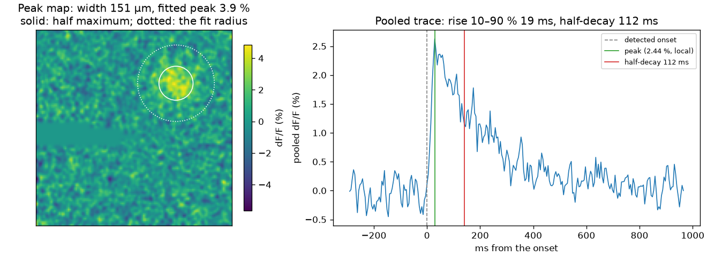

Spontaneous measure reference
=============================

Every number a detector can report, one by one: how it is named, its unit,
its definition, its formula, how it is computed, when it is left empty,
what it reflects and what to be careful of. *Italic* names are settings
(see :doc:`settings`). An empty value means "could not be measured"; it is
never replaced by 0, and summaries leave it out. Other words are explained
in the :doc:`../glossary`.

   How an event is measured: the first added event of :doc:`detector`'s
   figure (a peak of 4 %, 150 µm wide). Left: its peak map with the fitted
   Gaussian's half-maximum circle and the fit radius. Right: its pooled
   trace, with the detected onset, the peak and the half-decay.

Two sources
-----------

Most event measures come from one of two sources, both taken from the dF/F
movie the detector searched (step 2 of :doc:`detector`).

**The peak map** gives the event's size and centre:

1. Each pixel is taken relative to its mean from 45 frames before the
   onset up to 15 before, and blurred with a Gaussian of 1 pixel.
2. The peak is the frame, among the first 35 from 5 frames before the
   onset on, at which the mean of the pixels within 48 µm of the event's
   strongest pixel is highest (smoothed over 5 frames).
3. The map is the mean of 8 frames: from 3 before that peak to 4 after.
   When more than 100 tissue pixels lie farther than 480 µm from the
   event, their median is subtracted.
4. A :term:`Gaussian` peak·exp(−r²/2σ²) + offset, whose σ is the event's
   width, is fitted by :term:`least squares` to the map's tissue pixels
   within *Fit the width within*. It needs at least 200 such pixels. Its
   peak lies between 0 and 100 %, its width between 8 and 400 µm, its
   offset between −5 and 5 %, and its centre at most 128 µm from the
   event's strongest pixel.
5. The fit is **good** when its :term:`fit quality` reaches *Smallest fit
   quality*, its width is below *Largest width* and its peak is above 0.
   Otherwise width, fitted peak and size are empty, and the event's
   position is its strongest pixel.

**The pooled trace** gives the event's time course:

1. The dF/F movie from 60 frames before the onset to 200 after goes
   through the detector's spatial filter (and has each frame's tissue
   median subtracted, when the field-wide signal is removed).
2. The trace is read at the event's strongest pixel, taken relative to its
   median up to 10 frames before the onset, and smoothed over 3 frames.
3. Its peak is the largest value from 10 frames before the onset to 80
   after.

The pooling makes the trace clean enough to time, but lowers its peak, so
the *local peak* is lower than the *fitted peak*. A dim event's trace is
noisier, which tends to shorten its measured times.

Per event
---------

.. include:: ../_generated/spontaneous_reference_event.rst

Per recording
-------------

.. include:: ../_generated/spontaneous_reference_recording.rst

Per slice
---------

A slice is one recording folder: its measures pool all its searched
recordings.

.. include:: ../_generated/spontaneous_reference_slice.rst

.. include:: ../_generated/spontaneous_reference_summary.rst
